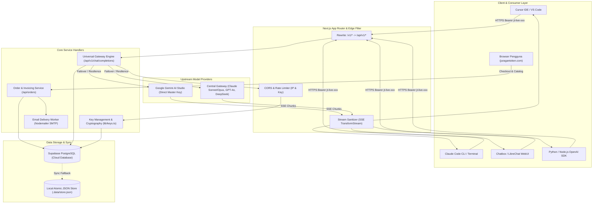

# 🏛️ Architecture & System Design Specification: Juragan Token

**Versi Dokumen:** 2.0.0  
**Target Pembaca:** Software Engineers, Systems Architects, DevOps, dan QA  
**Status:** Production Blueprint & Living Architecture  
**Pembaruan Terakhir:** November 2026  

---

## 1. Ikhtisar Arsitektur (*High-Level Architecture*)

Juragan Token dibangun dengan pola arsitektur **Modular Monolith** menggunakan **Next.js 16 (App Router)** yang mengintegrasikan layanan E-Commerce (Katalog, Checkout, QRIS) dengan **Universal AI Reverse Proxy Gateway** berperforma tinggi.



---

## 2. Siklus Alur Data Kritis (*Critical Data Lifecycles*)

### A. Lifecycle Checkout & Penerbitan API Key

1. **Pembuatan Order (`POST /api/orders`)**:
   - Menerima `packageId`, `customerName`, `customerEmail`, `methodId`.
   - Mengambil data harga resmi dari katalog server (angka harga dari client diabaikan untuk mencegah tampering).
   - Menghasilkan `invoiceId` (`INV-YYMMDD-XXXX`) dan `orderToken` acak.
   - Menyimpan order berstatus `pending` dengan TTL 15 menit.
2. **Pembayaran & Verifikasi (`POST /api/orders/[id]/confirm`)**:
   - Menerima webhook payment gateway atau konfirmasi admin (`x-admin-secret`).
   - Eksekusi idempoten: Jika order sudah berstatus `paid`, kunci tidak digenerate ulang.
   - Menghasilkan kunci baru:
     $$\text{raw\_key} = \text{"jt-live-"} + \text{crypto.randomBytes}(24).\text{toString}('hex')$$
     $$\text{key\_hash} = \text{SHA-256}(\text{raw\_key})$$
   - Menyimpan `key_hash`, `last4`, dan saldo awal ke tabel `keys`.
   - Menghapus kunci mentah dari memori setelah ditampilkan satu kali (*one-time reveal*) dan dikirimkan ke email pelanggan.

### B. Lifecycle Proxy AI Gateway & Pemotongan Saldo

1. **Autentikasi Kunci (`lib/gateway.ts: authenticateGatewayKey`)**:
   - Membaca header `Authorization: Bearer jt-live-...`.
   - Menghitung SHA-256 dari kunci yang diterima.
   - Mencocokkan hash di database. Jika ditemukan dan saldo $> 0$, request diizinkan.
2. **Penerusan ke Upstream**:
   - Model Gemini: Ditangani langsung via `GEMINI_API_KEY` ke Google AI Studio (`/v1beta/openai/chat/completions`).
   - Model Frontier (Claude, GPT, DeepSeek): Diteruskan ke Central Gateway Engine Juragan Token.
3. **Stream Sanitization**:
   - Google Gemini terkadang mengembalikan field `extra_content` atau `thought_signature` yang dapat membuat parser Cursor/Claude Code mengalami crash.
   - `createOpenAISanitizerStream` memfilter data baris SSE secara streaming sebelum sampai ke IDE pengguna.
4. **Pemotongan Saldo Atomik**:
   - Menghitung token prompt dan completion.
   - Memotong saldo rupiah secara atomik di database:
     $$\text{Saldo Akhir} = \text{Saldo Awal} - \text{Biaya Terhitung}$$
   - Merekam log pemakaian ke tabel `usage_logs`.

---

## 3. Skema Database PostgreSQL (Supabase DDL)

Berikut skema tabel terstruktur yang diterapkan pada sistem produksi:

```sql
-- 1. Tabel Pesanan (Orders)
CREATE TABLE IF NOT EXISTS public.orders (
    id VARCHAR(32) PRIMARY KEY,
    customer_name VARCHAR(100) NOT NULL,
    customer_email VARCHAR(150) NOT NULL,
    customer_phone VARCHAR(30),
    package_id VARCHAR(50) NOT NULL,
    package_name VARCHAR(100) NOT NULL,
    est_package VARCHAR(50),
    base_idr NUMERIC(12,2) NOT NULL,
    fee_idr NUMERIC(12,2) DEFAULT 0,
    total_idr NUMERIC(12,2) NOT NULL,
    method_id VARCHAR(50) NOT NULL,
    method_name VARCHAR(100) NOT NULL,
    status VARCHAR(20) DEFAULT 'pending' CHECK (status IN ('pending', 'paid', 'expired', 'failed')),
    token_hash CHAR(64) NOT NULL,
    key_hash CHAR(64),
    paid_at TIMESTAMP WITH TIME ZONE,
    email_status VARCHAR(20) DEFAULT 'none',
    email_message TEXT,
    created_at TIMESTAMP WITH TIME ZONE DEFAULT NOW()
);

-- 2. Tabel API Keys
CREATE TABLE IF NOT EXISTS public.keys (
    hash CHAR(64) PRIMARY KEY,
    last4 CHAR(4) NOT NULL,
    order_id VARCHAR(32) REFERENCES public.orders(id) ON DELETE SET NULL,
    plan_name VARCHAR(100) NOT NULL,
    est_package VARCHAR(50),
    balance_idr NUMERIC(14,4) NOT NULL CHECK (balance_idr >= 0),
    status VARCHAR(20) DEFAULT 'active' CHECK (status IN ('active', 'suspended', 'revoked')),
    rpm_limit INT DEFAULT 60,
    created_at TIMESTAMP WITH TIME ZONE DEFAULT NOW(),
    updated_at TIMESTAMP WITH TIME ZONE DEFAULT NOW()
);

-- 3. Tabel Log Pemakaian (Usage Logs)
CREATE TABLE IF NOT EXISTS public.usage_logs (
    id BIGSERIAL PRIMARY KEY,
    key_hash CHAR(64) REFERENCES public.keys(hash) ON DELETE CASCADE,
    key_last4 CHAR(4),
    model VARCHAR(100) NOT NULL,
    provider VARCHAR(50) NOT NULL,
    prompt_tokens INT NOT NULL DEFAULT 0,
    completion_tokens INT NOT NULL DEFAULT 0,
    total_tokens INT NOT NULL DEFAULT 0,
    cost_idr NUMERIC(10,4) NOT NULL,
    remaining_balance_idr NUMERIC(14,4) NOT NULL,
    latency_ms INT,
    created_at TIMESTAMP WITH TIME ZONE DEFAULT NOW()
);

-- Indeks Kinerja
CREATE INDEX IF NOT EXISTS idx_orders_created_at ON public.orders(created_at DESC);
CREATE INDEX IF NOT EXISTS idx_orders_status ON public.orders(status);
CREATE INDEX IF NOT EXISTS idx_keys_status ON public.keys(status);
CREATE INDEX IF NOT EXISTS idx_usage_logs_key_hash ON public.usage_logs(key_hash);
CREATE INDEX IF NOT EXISTS idx_usage_logs_created_at ON public.usage_logs(created_at DESC);
```

---

## 4. Algoritma Utama & Logika Teknis

### A. Algoritma Pemotongan Saldo Atomik (*Anti-Race Condition*)
Ketika klien mengirim 10 prompt paralel dari Cursor, pemotongan saldo tidak boleh dibaca-lalu-tulis (*read-then-write*) di memori aplikasi karena rentan *race condition*. Pemotongan dieksekusi secara atomik di engine SQL:

```sql
CREATE OR REPLACE FUNCTION deduct_token_balance(
    target_key_hash CHAR(64),
    deduct_amount NUMERIC
) RETURNS TABLE(success BOOLEAN, new_balance NUMERIC) AS $$
BEGIN
    UPDATE public.keys
    SET balance_idr = balance_idr - deduct_amount,
        updated_at = NOW()
    WHERE hash = target_key_hash 
      AND status = 'active'
      AND balance_idr >= deduct_amount
    RETURNING balance_idr INTO new_balance;

    IF FOUND THEN
        RETURN QUERY SELECT TRUE, new_balance;
    ELSE
        SELECT balance_idr INTO new_balance FROM public.keys WHERE hash = target_key_hash;
        RETURN QUERY SELECT FALSE, COALESCE(new_balance, 0);
    END IF;
END;
$$ LANGUAGE plpgsql;
```

### B. Algoritma Kalkulasi Biaya Token (IDR)
Kalkulasi biaya per panggilan dihitung secara presisi berdasarkan rasio token input/output dan kurs live:

$$\text{Input Cost} = \left(\frac{\text{Prompt Tokens}}{1.000.000}\right) \times \text{Input Price USD} \times \text{Kurs USD/IDR}$$

$$\text{Output Cost} = \left(\frac{\text{Completion Tokens}}{1.000.000}\right) \times \text{Output Price USD} \times \text{Kurs USD/IDR}$$

$$\text{Total Deducted} = \max\left(5, \lceil \text{Input Cost} + \text{Output Cost} \rceil\right)$$

*Minimum pemotongan per request dibatasi Rp 5 untuk mencegah eksploitasi mikro-request.*

---

## 5. Keamanan & Kepatuhan (*Security Standards*)

1. **Zero-Knowledge Token Storage**: Server tidak menyimpan string `jt-live-...` secara mentah. Pencocokan selalu menggunakan `crypto.createHash('sha256').update(key).digest('hex')`.
2. **Perlindungan Serangan Timing (*Timing Attack Protection*)**: Semua perbandingan string rahasia (seperti `ADMIN_SECRET` dan order token) menggunakan `crypto.timingSafeEqual` melalui helper `safeEqualHash()`.
3. **CORS Sanitization**: Header `Access-Control-Allow-Origin: *` diaktifkan khusus untuk endpoint `/api/v1/*` agar dapat diakses dari Web SDK, VS Code extensions, dan client browser lokal.
4. **Rate Limiting**:
   - Cek Saldo & Order Creation: 10–20 request per menit per alamat IP.
   - AI Gateway Inference: 60 Request Per Minute (RPM) per API Key.
