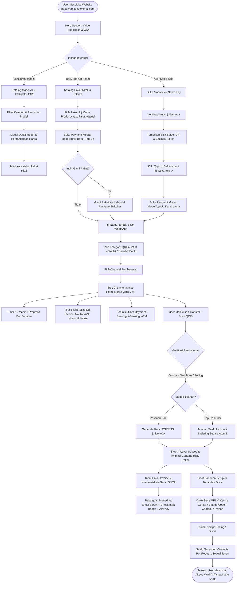
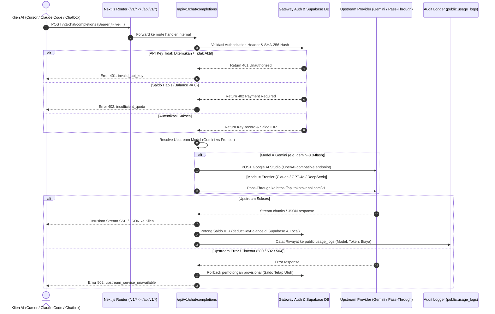
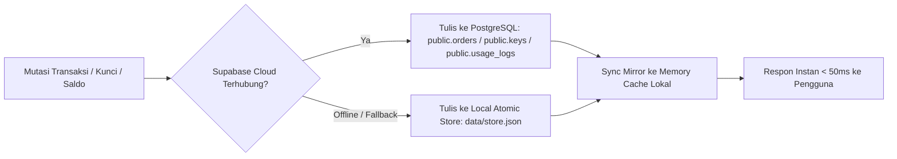
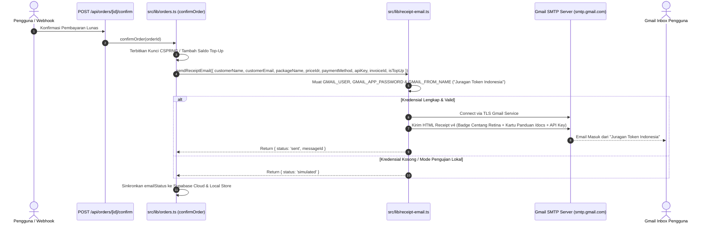
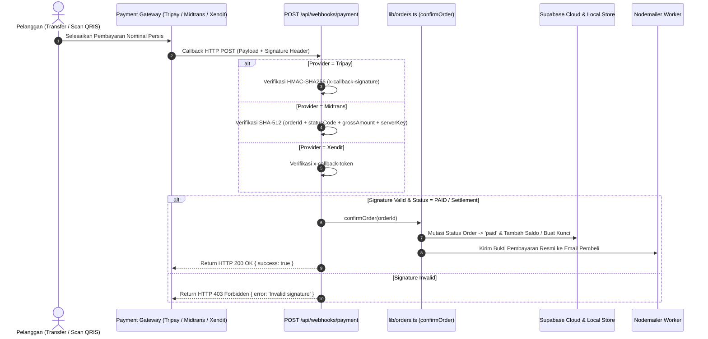

# Product Requirement Document (PRD): Juragantoken

**Versi Dokumen:** 4.1.0  
**Status:** Living Document / Streamlined Company Profile, Enterprise B2B & Standard Gateway, User & Admin Portal  
**Tanggal Pembaruan:** 24 November 2026  
**Platform:** Web Application (Next.js 16.4.6 App Router, React 19, TypeScript, Vanilla CSS + Responsive Flexbox, Supabase Cloud)  
**Entitas Resmi:** PT Rejeki Digital Cemerlang  
**Domain Utama:** `https://api.tokotokenai.com`  
**Repository:** `Whyzenn07/juragan-token-web`  

---

## 1. Ikhtisar Produk (Product Overview — Selaras 12 Slide PDF PT Rejeki Digital Cemerlang)

### 1.1 Positioning & 2 Pilar Utama
**Juragantoken** (`One Gateway. Every Intelligence.`) adalah gerbang utama API AI terpadu di Indonesia yang dikelola resmi oleh **PT Rejeki Digital Cemerlang** untuk menjembatani **kebutuhan teknis tim IT** sekaligus **efisiensi administratif tim Purchasing/Finance**, sambil tetap menyediakan jalur **Standard** yang fleksibel bagi developer dan tim kecil:

1. **Pilar Tim IT (Keunggulan Teknis & Keamanan):**
   - **1 Universal API Key (`jt-live-...`)** & **1 Base URL (`https://api.tokotokenai.com/v1`)** untuk mengakses 100+ model AI lintas 10+ provider (Anthropic Claude Opus/Sonnet 5.5, OpenAI Chat GPT 6 Astra / GPT-6 Sol, Google Gemini 4 Argon / 3.8 Flash, DeepSeek V4, Alibaba Qwen 3.7, xAI Grok 4, Kimi, MiniMax, GLM, Seed).
   - **Kontrol Whitelist IP Enterprise (`allowed_ips`):** Membatasi akses API Key hanya dari IP kantor atau server produksi (`403 ip_not_whitelisted_or_inactive` bagi IP tidak dikenal).
   - **Zero-Training & Zero-Retention Privacy:** Enkripsi TLS 1.3 dan hashing API Key satu arah SHA-256 tanpa menyimpan isi percakapan/kode sumber pengguna.
2. **Pilar Tim Purchasing & Legal (Kepatuhan & Efisiensi Korporat):**
   - **Legalitas PT Lokal Resmi (`PT Rejeki Digital Cemerlang`):** Menyediakan Invoice B2B resmi dalam Rupiah (IDR), dukungan **Faktur Pajak & NPWP**, tanpa kartu kredit luar negeri, bebas biaya valas (*cross-border fees*), dan menghapus beban reimbursement karyawan.
   - **Dukungan Langsung Principal & Keamanan Deposit 100%:** Saldo kredit permanen tanpa kedaluwarsa bulanan, SLA WhatsApp lokal (`0812-2698-3990` pada mode uji), dan jalur infrastruktur *High Availability*.
3. **Jalur Standard Fleksibel:**
   - Developer individu, startup tahap awal, dan akademisi dapat mendaftar langsung di `/signup`, memesan kredit IDR mulai Rp 15.000 via QRIS/Transfer Bank di `/dashboard`, dan langsung menerima *Universal API Key* tanpa minimum kontrak besar.

### 1.2 Latar Belakang & Masalah Fragmentasi (Slide 2 PDF)
Adopsi kecerdasan buatan modern di perusahaan maupun tim developer Indonesia menghadapi 3 hambatan utama:
1. **Tim IT — Titik Buta Keamanan & Fragmentasi SDK:** Penggunaan API key pihak ketiga yang tersebar tanpa kontrol akses IP serta pemeliharaan banyak SDK/kredensial berbeda per provider.
2. **Tim Purchasing — Kekacauan Administratif & Reimbursement:** Ratusan transaksi kartu kredit pribadi karyawan dan klaim *petty cash* berulang setiap bulan.
3. **Legal & Compliance — Risiko Kepatuhan & Biaya Valas:** Pembayaran ke entitas asing tanpa faktur pajak lokal resmi serta beban kurs dan biaya transaksi lintas negara.

---

## 2. Arsitektur & Diagram Alur (Flowcharts)

### 2.1 Alur Pengguna Utama (End-to-End Customer Journey)



---

### 2.2 Alur Universal AI Gateway & Deduplikasi Saldo (AI Inference Flowchart)



---

### 2.3 Alur Dual-Persistence Data (Cloud Database & Local Fallback)



---

### 2.4 Alur Sistem Notifikasi Email Server-Side (Gmail SMTP Integration)



---

### 2.5 Alur Webhook Otomatis Payment Gateway (Tripay, Midtrans, Xendit)



---

## 3. Spesifikasi Fungsional Produk (Feature Specifications)

| Modul | Komponen / Endpoint | Deskripsi Fungsional & Standar Teknis |
| :--- | :--- | :--- |
| **Universal AI Gateway** | `/v1/chat/completions`<br>`/api/v1/chat/completions` | Endpoint kompatibel 100% dengan OpenAI API. Mendukung Server-Sent Events (SSE) streaming dengan sanitasi chunk otomatis (`createOpenAISanitizerStream`), multi-tier Gemini resilience, proteksi rate-limiting (60/20 RPM), dan batas konkurensi 5 stream per key. |
| **Model Registry & Sync** | `/v1/models`<br>`/api/models/sync` | Mengembalikan daftar model yang tersedia (`gemini-3.8-flash`, `gemini-1.5-pro`, `claude-sonnet-5-5`, `claude-opus-5-5`, `gpt-4o`, `deepseek-chat`). Sinkronisasi harga live IDR per 1k token. |
| **Router Rewrite** | `next.config.ts` | Konfigurasi internal rewrites: mapping otomatis dari `/v1/:path*` ke `/api/v1/:path*` agar klien AI pihak ketiga (Cursor/Claude CLI) dapat langsung memanggil root URL. |
| **Deduplikasi Saldo & Metering** | `src/lib/gateway.ts` | Perhitungan tarif rupiah riil per request berdasarkan jumlah token input/output (baik non-streaming maupun akumulasi dinamis SSE streaming). Mengurangi `balance_idr` secara atomik via RPC `deduct_token_balance` di Supabase dan lokal. |
| **Audit Usage Logging** | `public.usage_logs` | Pencatatan riwayat pemakaian API setiap kali request inferensi selesai (mencatat model, provider, prompt tokens, completion tokens, biaya IDR, dan sisa saldo). |
| **Portal Cek Saldo & Riwayat Key** | `TokenBalanceModal.tsx`<br>`/api/keys/check` | Modal verifikasi saldo sisa IDR, estimasi token, status keaktifan permanen, tampilan daftar **Histori Pemakaian Terbaru** langsung dari `public.usage_logs`, proteksi rate-limiting (15 req/menit), masking kunci (`jt-live-...xxxx`), dan tombol 1-klik "Tempel Kunci Terakhir". |
| **Integrasi Cek Saldo ➔ Direct Top-Up** | `TokenBalanceModal.tsx` ➔ `PaymentModal.tsx` | Alur konversi langsung: tombol *"Top-Up Saldo Kunci Ini Sekarang ↗"* membuka kasir checkout dalam mode `topup` dengan data API Key yang langsung terisi dan terverifikasi otomatis. |
| **Mode Top-Up Kunci yang Ada** | `PaymentModal.tsx`<br>`src/lib/orders.ts` | Mode khusus untuk pelanggan lama yang ingin menambah saldo ke kunci yang sama tanpa perlu mengubah konfigurasi API key di Cursor atau terminal. |
| **In-Modal Package Switcher** | `PaymentModal.tsx` | Pemilih paket interaktif di dalam kartu ringkasan pesanan (*order summary*) untuk berpindah paket secara instan tanpa perlu menutup modal. |
| **Universal Webhook Engine** | `/api/webhooks/payment/route.ts` | Endpoint terpadu yang memproses notifikasi pembayaran otomatis (`PAID` & `EXPIRED`) dari Tripay (HMAC-SHA256), Midtrans (SHA-512), dan Xendit beserta sinkronisasi penuh ke Supabase. |
| **Sinkronisasi Kurs Real-Time (BI Rate)** | `CurrencyRateModal.tsx`<br>`src/app/page.tsx` | Menampilkan modal kurs valas Bank Indonesia dengan visual grafik tren historis (1HR s/d Maks), perhitungan margin proteksi selisih kurs, dan pemicu pembaruan katalog tarif live. |
| **Kalkulator Penghematan AI** | `SavingsCalculator.tsx` | Kalkulator interaktif perbandingan biaya langganan bulanan ($20/bulan) vs sistem prabayar IDR Juragan Token sesuai intensitas pemakaian pengguna. |
| **Katalog Model Favorit** | `src/app/page.tsx` | Fitur simpan/bookmark model AI favorit dengan filter `Tersimpan (★)` yang tersimpan di memori browser pengguna. |
| **Panduan Setup 4-in-1 & Halaman `/docs`** | `SetupGuides.tsx`<br>`src/app/docs/page.tsx` | Tab panduan interaktif siap salin di beranda serta halaman dokumentasi mandiri (`/docs`) untuk: Cursor AI, Windsurf, Claude Code CLI, Chatbox, dan Python/Node.js SDK. |
| **Halaman Status & Kesehatan Cloud** | `src/app/status/page.tsx`<br>`/api/supabase/status` | Dashboard pemantauan status operasional gateway, latensi database Supabase Cloud, dan sinkronisasi dua arah (`syncBidirectionalStore`). |
| **Halaman Legalitas & Kepatuhan** | `/privacy`, `/terms` | Halaman Kebijakan Privasi (*Zero-Retention Prompt Privacy*) dan Syarat & Ketentuan layanan ritel kredit API. |
| **Sistem Checkout Multi-Channel & Accordion** | `PaymentModal.tsx` | Modal checkout 3 langkah dengan navigasi accordion interaktif bersusun halus (QRIS, VA & e-Wallet, Transfer Bank), validasi anti-typo domain email (`@gmai.com`, dll.), dan integrasi WhatsApp. |
| **Invoice Standar Traveloka / Tiket.com** | `PaymentModal.tsx` (Step 2) | Layar invoice pembayaran resmi OTA benchmark: countdown timer 15 menit dengan recovery batas waktu habis, tombol 1-klik salin nomor invoice, salin nomor rekening/VA, salin nominal persis, serta petunjuk pembayaran multi-tab. |
| **Floating WhatsApp & Notifikasi CS** | `FloatingWhatsApp.tsx`<br>`PaymentModal.tsx` | Tombol mengambang (*floating widget*) konsultasi WhatsApp di pojok kanan bawah layar (responsif desktop & mobile), konfirmasi bayar WhatsApp di Step 2, dan cadangkan kredensial di Step 3 (`081226983990`). |
| **Layanan Email Kuitansi Otomatis** | `src/lib/receipt-email.ts`<br>`/api/test-email` | Pengiriman bukti bayar resmi dan kredensial API Key otomatis dari server (`confirmOrder`) via Gmail SMTP dengan nama pengirim **Juragan Token Indonesia**, badge centang Retina identik website (`PaymentSuccessMark`), dan tombol panduan `/docs`. |
| **SEO & OpenGraph Metadata** | `src/app/layout.tsx` | Metadata komersial profesional: Title, Description berdaya konversi tinggi, OpenGraph WhatsApp preview, Twitter card, Canonical URL, dan bebas dari kata "simulasi". |

---

### 3.1 Arsitektur Pembayaran & Standar Desain Invoice (Benchmark Traveloka & Tiket.com)

1. **Pengelompokan Kanal Pembayaran (Interactive Accordion):**
   - **QRIS Instan:** Mendukung BCA, Mandiri, BRI, BNI, GoPay, OVO, ShopeePay, DANA, dan LinkAja (Bebas Biaya Admin, verifikasi instan).
   - **Virtual Account & e-Wallet:** Menampilkan 8 pilihan (DANA, ShopeePay, OVO, GoPay, BCA VA, Mandiri VA, BRI VA, BNI VA) dengan badge biaya transparan.
   - **Transfer Bank:** 5 bank nasional (BCA, Mandiri, BRI, BNI, BSI) dengan verifikasi cepat & rekening terdaftar resmi.
2. **Layar Invoice Resmi (Step 2):**
   - **Timer Dinamis:** 15 menit hitung mundur dengan progress bar visual berwarna emas/amber dan tombol *Perbarui Tagihan ↻* saat kedaluwarsa.
   - **Identitas Invoice & Order ID:** Nomor unik (`INV-YYYYMMDD-XXXX`) dengan tombol 1-klik salin.
   - **Nomor Rekening / VA Monospace Fit:** Disajikan dengan spasi terpisah yang pas tanpa terpotong di layar mobile berlayar sempit.
   - **Nominal Transfer Persis:** Angka rupiah total tebal dengan tombol 1-klik salin jumlah transfer.
   - **Petunjuk Cara Pembayaran Multi-Tab:** Tab interaktif `m-Banking`, `i-Banking`, dan `ATM`.

---

## 4. Status Implementasi Detail (Audit Codebase)

```
[✓] SUDAH DIIMPLEMENTASIKAN (100% Siap & Berfungsi di Codebase)
[~] SEBAGIAN / SIAP AKTIVASI (Logika Siap, Memerlukan Kredensial / Saklar Produksi)
[ ] ROADMAP TAHAP BERIKUTNYA
```

### 4.1 AI Gateway & Inference Engine
- [x] **[✓] Endpoint Kompatibel OpenAI (`/v1/chat/completions`):** Streaming SSE & non-streaming JSON aktif dengan sanitasi chunk otomatis.
- [x] **[✓] Endpoint Daftar Model (`/v1/models`):** JSON response berstandar OpenAI models schema.
- [x] **[✓] Rewrites Router (`next.config.ts`):** Mapping `/v1/*` ke `/api/v1/*` selesai.
- [x] **[✓] Direct Master Key Routing Google Gemini:** Routing `gemini-3.8-flash` & `gemini-1.5-pro` langsung ke Google AI Studio dengan multi-tier resilience & key pool rotation.
- [x] **[✓] Pass-Through Engine Frontier Models:** Routing Claude Opus 5.5, Claude Sonnet 5.5, GPT-4o, dan DeepSeek diteruskan ke `UPSTREAM_ENGINE_URL` (`api.tokotokenai.com`) dengan graceful fallback.
- [x] **[✓] Pemotongan Saldo Real-Time (`deductKeyBalance`):** Pemotongan IDR per request berbasis volume token dinamis (baik JSON maupun akumulasi SSE streaming) via RPC atomik Supabase.
- [x] **[✓] Rate-Limiting & Concurrency Protection:** Pembatasan 60 RPM (model umum), 20 RPM (frontier), dan maksimal 5 stream simultan per API key.
- [x] **[✓] Audit Log Pemakaian (`recordUsageLog`):** Pencatatan riwayat pemakaian ke `public.usage_logs` dan ditampilkan langsung di modal Cek Saldo.

### 4.2 Data & Database Cloud (Supabase)
- [x] **[✓] Migrasi Tabel Orders & Keys:** `public.orders` (termasuk kolom `is_top_up` & `target_key_hash`) dan `public.keys` aktif dengan Row Level Security (RLS).
- [x] **[✓] Migrasi Tabel Usage Logs:** `public.usage_logs` aktif dengan indeks pencarian per key hash dan waktu.
- [x] **[✓] Autentikasi Kunci SHA-256:** Kunci `jt-live-...` dienkripsi satu arah dengan SHA-256 sebelum disimpan. Kunci mentah tidak pernah disimpan permanen di database.
- [x] **[✓] Serverless Dual-Persistence & Hydration:** Sinkronisasi otomatis ke Supabase Cloud untuk seluruh status pesanan (`pending`, `paid`, `expired`) dengan fallback `/tmp/juragan-token-store.json` di Vercel.

### 4.3 E-Commerce, Kasir, Email & Bantuan Pelanggan
- [x] **[✓] Alur Checkout Kunci Baru & Top-Up Kunci Eksisting:** Teruji penuh di `PaymentModal.tsx` dan `orders.ts`.
- [x] **[✓] In-Modal Package Switcher:** Pengguna dapat berpindah paket ritel langsung di dalam modal.
- [x] **[✓] Integrasi Direct Top-Up & Riwayat Pemakaian di Cek Saldo:** Menampilkan daftar pemakaian terakhir dari `usage_logs` serta tombol *"Top-Up Saldo Kunci Ini Sekarang ↗"*.
- [x] **[✓] Universal Webhook Handler (`/api/webhooks/payment`):** Verifikasi signature Tripay, Midtrans, dan Xendit.
- [x] **[✓] Email Kuitansi Otomatis Gmail SMTP (`receipt-email.ts`):** Terkirim otomatis atas nama **Juragan Token Indonesia** lengkap dengan badge centang Retina identik website dan panduan `/docs`.
- [x] **[✓] Floating WhatsApp Consultation Widget (`FloatingWhatsApp.tsx`):** Tombol bantuan mengambang responsif di pojok kanan bawah layar.
- [x] **[✓] Panduan Setup Interaktif 4-in-1 & Halaman `/docs`, `/status`, `/privacy`, `/terms`:** Lengkap dan aktif.
- [x] **[✓] Metadata SEO & OpenGraph:** Tampilan share WhatsApp profesional dan bebas kata "simulasi".

### 4.4 Komponen Kesiapan Operasional Eksternal (Pending Activation)
- [ ] **[~] Pengalihan Mode Demo ke Live (`DEMO_MODE=false` & `NEXT_PUBLIC_DEMO_MODE=false`):** Saklar siap diputar ke `false` saat API Create Transaction Payment Gateway riil diaktifkan.
- [ ] **[~] Gambar QRIS Merchant Resmi / Dynamic QRIS API:** Menunggu unggah gambar QRIS berizin resmi ber-NMID atau kredensial produksi Midtrans/Tripay/Xendit.
- [x] **[✓] Sandi Aplikasi Gmail SMTP (16 Karakter):** Sudah dikonfigurasi dan aktif mengirim email di Vercel Production.

---

## 5. Spesifikasi Teknis Metering Saldo & Tarif IDR

Setiap request yang melalui gateway `/v1/chat/completions` dihitung biayanya menggunakan rumus berbasis jumlah total token:

$$\text{Biaya (IDR)} = \left\lceil \frac{\text{Prompt Tokens} + \text{Completion Tokens}}{1.000} \times \text{Tarif Model} \right\rceil$$

### 5.1 Tabel Acuan Tarif Model di Gateway

| Kategori Model | Model yang Didukung | Tarif per 1.000 Tokens | Minimal Potong per Request | Jalur Pemrosesan |
| :--- | :--- | :---: | :---: | :--- |
| **Gemini Flash (Super Hemat)** | `gemini-3.8-flash`, `gemini-2.0-flash` | **Rp 20** | Rp 5 | Direct Google AI Studio |
| **Gemini Pro (Analisis & Riset)** | `gemini-1.5-pro`, `gemini-pro-latest` | **Rp 60** | Rp 10 | Direct Google AI Studio |
| **Frontier Coding (Cerdas)** | `claude-sonnet-5-5`, `claude-3-5-sonnet` | **Rp 200** | Rp 25 | Pass-Through Central Engine |
| **Frontier Reasoning (Ultimate)** | `claude-opus-5-5`, `gpt-4o`, `deepseek-chat` | **Rp 200** | Rp 25 | Pass-Through Central Engine |

*Catatan untuk Streaming (SSE):* Saat client menggunakan opsi `stream: true`, sistem memotong estimasi saldo provisional di awal stream, mencatat log audit pemakaian, dan jika upstream gagal merespons, saldo provisional di-rollback seketika.

---

## 6. Spesifikasi Integrasi Klien (4-in-1 Client Connectors)

Sistem Juragan Token menjamin kompatibilitas 100% dengan 4 alat kerja utama pengembang:

### 6.1 Cursor AI & Windsurf IDE
- **Base URL:** `https://api.tokotokenai.com/v1` (atau `http://localhost:3000/v1` pada tahap lokal)
- **API Key:** `jt-live-xxxxxxxxxxxxxxxxxxxx`
- **Model Override:** `claude-sonnet-5-5`, `gpt-4o`, `gemini-3.8-flash`
- **Konfigurasi:** Masuk ke `Cursor Settings` > `Models` > Aktifkan `OpenAI API Key` > Masukkan Base URL & API Key.

### 6.2 Claude Code CLI (Terminal Anthropic)
- **Environment Variables:**
  ```bash
  export ANTHROPIC_BASE_URL="https://api.tokotokenai.com/v1"
  export ANTHROPIC_API_KEY="jt-live-xxxxxxxxxxxxxxxxxxxx"
  ```
- **Eksekusi:** Jalankan perintah `claude` langsung di terminal kerja.

### 6.3 Chatbox (Desktop & Web App)
- **AI Model Provider:** Pilih `OpenAI API`
- **API Host:** `https://api.tokotokenai.com` (otomatis menambahkan `/v1`)
- **API Key:** `jt-live-xxxxxxxxxxxxxxxxxxxx`
- **Model:** `claude-opus-5-5` atau `gemini-3.8-flash`

### 6.4 Python OpenAI SDK
```python
from openai import OpenAI

client = OpenAI(
    base_url="https://api.tokotokenai.com/v1",
    api_key="jt-live-xxxxxxxxxxxxxxxxxxxx"
)

response = client.chat.completions.create(
    model="gemini-3.8-flash",
    messages=[{"role": "user", "content": "Halo Juragan Token!"}]
)
print(response.choices[0].message.content)
```

---

## 7. Matriks Variabel Lingkungan (Environment Variables Matrix)

| Nama Variabel | Wajib/Opsional | Nilai Default / Format | Fungsi & Keterangan |
| :--- | :---: | :--- | :--- |
| `NEXT_PUBLIC_APP_URL` | Wajib | `https://api.tokotokenai.com` | URL domain publik website untuk penentuan canonical SEO & OpenGraph. |
| `GATEWAY_BASE_URL` | Wajib | `https://api.tokotokenai.com/v1` | URL gateway acuan pada email bukti pembayaran. |
| `NEXT_PUBLIC_SUPABASE_URL` | Wajib | `https://nzcblpzianzbgbwglhxc.supabase.co` | Endpoint REST API Cloud PostgreSQL Supabase. |
| `NEXT_PUBLIC_SUPABASE_ANON_KEY` | Wajib | `sb_publishable_...` | Kunci anon/publishable untuk query frontend & backend ke Supabase. |
| `SUPABASE_SECRET_KEY` | Opsional | `sb_secret_...` | Service Role Key untuk bypass RLS (keperluan migrasi database). |
| `GEMINI_API_KEY` | Wajib | `AQ.Ab8RN6KZoZ...` | Master API Key Google AI Studio untuk pemrosesan direct model Gemini Flash/Pro. |
| `UPSTREAM_ENGINE_URL` | Wajib | `https://api.tokotokenai.com/v1` | Endpoint Central Engine untuk pass-through request Claude/GPT-4o/DeepSeek. |
| `UPSTREAM_ENGINE_KEY` | Opsional | `sk-...` | Token otentikasi internal jika Central Engine mewajibkan master header khusus. |
| `TRIPAY_PRIVATE_KEY` | Opsional | String Kunci Rahasia | Kunci rahasia untuk validasi HMAC-SHA256 callback Tripay. |
| `MIDTRANS_SERVER_KEY` | Opsional | String Kunci Server | Kunci rahasia untuk validasi hash SHA-512 callback Midtrans. |
| `XENDIT_CALLBACK_TOKEN` | Opsional | String Token | Token verifikasi header callback webhook Xendit. |
| `GMAIL_USER` | Opsional | `email@gmail.com` | Alamat Gmail resmi pengirim kuitansi pembelian. |
| `GMAIL_APP_PASSWORD` | Opsional | 16 Karakter Sandi Aplikasi | Sandi aplikasi Google untuk otentikasi aman tanpa 2FA. |
| `GMAIL_FROM_NAME` | Opsional | `Juragan Token Indonesia` | Nama pengirim yang tampil di inbox pembeli. |
| `NEXT_PUBLIC_WHATSAPP_NUMBER` | Wajib | `6281226983990` | Nomor WhatsApp resmi Customer Care & Konfirmasi Pesanan. |
| `DEMO_MODE` | Wajib | `"true"` atau `"false"` | Mengontrol tombol simulasi bayar di backend. |
| `NEXT_PUBLIC_DEMO_MODE` | Wajib | `"true"` atau `"false"` | Mengontrol tampilan badge dan tombol simulasi di modal frontend. |
| `ADMIN_SECRET` | Wajib | String acak panjang | Kunci pengaman untuk memicu konfirmasi manual pesanan via API. |

---

## 8. Tata Kelola, Keamanan & Metrik Produk (Product Governance & KPIs)

### 8.1 Kebijakan Privasi Data & Zero-Prompt Retention
Juragan Token didesain dengan prinsip keamanan data (*privacy-by-design*):
- **Stateless Streaming:** Seluruh payload percakapan pengguna (prompt, kode, dokumen, instruksi sistem) diteruskan secara langsung ke upstream provider melalui memori RAM tanpa pernah disimpan ke disk lokal maupun database PostgreSQL.
- **Audit Terbatas:** Tabel audit `usage_logs` hanya mencatat metrik kuantitatif: hash kunci API, nama model, jumlah prompt token, completion token, biaya rupiah, dan stempel waktu.

### 8.2 Concurrency Control & Runaway Spend Protection
- **Batas Konkurensi:** Maksimal 5 stream simultan per API key untuk menjaga stabilitas jalur upstream.
- **Rate-Limiting Kunci:** 60 request/menit untuk model umum, 20 request/menit untuk model frontier reasoning.
- **Pencegahan Saldo Minus:** Validasi saldo ketat sebelum inferensi dimulai memastikan pemakaian tidak pernah melampaui sisa saldo rupiah.

### 8.3 Target Metrik Keberhasilan Produk (KPIs)
1. **Checkout Completion Rate:** $\ge 70\%$ dari pengunjung yang membuka modal checkout berhasil menyelesaikan transaksi hingga `paid`.
2. **Top-Up Retention Rate:** $\ge 40\%$ pelanggan aktif melakukan pengisian ulang saldo dalam 30 hari.
3. **Gateway Proxy Latency Overhead:** Rata-rata penambahan latensi oleh gateway $\le 45\text{ ms}$.
4. **Instant Payment Activation:** Pembayaran terkonfirmasi otomatis dan kunci/saldo aktif dalam waktu $\le 5\text{ detik}$.

---

## 9. Langkah Verifikasi Fungsional (Sebelum Go-Live)

1. **Uji Coba Inferensi Kunci Aktif:**
   - Gunakan kunci aktif yang ada di database (`jt-live-ALbbK0UWHQg0ezVDdoFeDDzU`) untuk memanggil `POST /v1/chat/completions` dengan model `gemini-3.8-flash`.
   - Pastikan saldo di Supabase berkurang sesuai formula tarif.
   - Pastikan log transaksi tercatat di tabel `public.usage_logs`.
2. **Uji Coba Portal Cek Saldo & Top-Up Terusan:**
   - Masukkan kunci ke modal *Cek Saldo Key* di beranda.
   - Tekan tombol *Top-Up Saldo Kunci Ini Sekarang ↗* dan pastikan kasir terbuka dalam mode top-up dengan kunci terisi.
3. **Uji Coba Alur SingaPay Modal & In-Modal Switcher:**
   - Buka modal pembayaran, uji tombol ganti paket dan beralih antara QRIS dan Transfer Bank.
4. **Transisi Produksi Terakhir:**
   - Masukkan Sandi Aplikasi Gmail ke `GMAIL_APP_PASSWORD`.
   - Unggah gambar QRIS merchant resmi.
   - Ubah `NEXT_PUBLIC_DEMO_MODE="false"`.


---

## 10. Pembaruan v3.0.0 — Company Profile, Showcase Keahlian Model AI, & Roadmap Enterprise B2B

### 10.1 Perubahan Positioning & Mode Tampilan (`NEXT_PUBLIC_ENABLE_CHECKOUT`)
Pada rilis **v3.0.0**, tampilan depan website **Juragantoken** (`One Gateway. Every Intelligence.`) difokuskan sebagai **Company Profile & Katalog Keahlian Model LLM** tanpa menghapus kode backend pembayaran yang sudah dibangun:
- **Feature Flag (`src/lib/site-config.ts`):**
  - `ENABLE_CHECKOUT = process.env.NEXT_PUBLIC_ENABLE_CHECKOUT === "true"` (default: `false`).
  - `SHOW_CATALOG_PRICING = ENABLE_CHECKOUT` (default: `false`).
- **Saat Mode Company Profile (`ENABLE_CHECKOUT = false`):**
  - Seluruh tombol *"Beli Token"*, seksi *Paket Prabayar Ritel* (`#katalog-retail`), *Bundle Banner*, serta nominal harga Rupiah per token/gambar disembunyikan dari UI kartu katalog maupun `ModelDetailModal`.
  - Seluruh route backend (`/api/orders`, `/api/webhooks/payment`, `/api/v1/chat/completions`, `/api/keys/check`) dan komponen `PaymentModal.tsx` tetap tersimpan utuh di codebase dan dapat diaktifkan kembali kapan saja dengan menyetel `NEXT_PUBLIC_ENABLE_CHECKOUT="true"`.
  - Nomor WhatsApp untuk pengujian dan konsultasi tetap menggunakan `0812-2698-3990` (`NEXT_PUBLIC_WHATSAPP_NUMBER`).

### 10.2 Kurasi Keahlian & Efektivitas Model AI
Untuk membantu calon pengguna dan tim teknis memilih model yang tepat tanpa kebingungan ratusan nama model, halaman utama menyediakan **Showcase Keahlian Model (`ModelExpertiseShowcase.tsx`)** dan **Animasi Marquee Model (`LogoMarquee.tsx`)** yang terbagi ke dalam tiga fokus beban kerja:
1. **Ngoding & Arsitektur Sistem:**
   - **Model Unggulan:** `Claude Opus 5.5` (`claude-opus-5-5`), `Chat GPT 6 Astra` (`chatgpt-6-astra`), `Gemini 4 Argon` (`gemini-4-argon`), serta `Claude Sonnet 5.5` (`claude-sonnet-5-5`).
   - **Efektivitas:** Refactoring multi-file, debugging algoritma kompleks, perancangan API/database, dan integrasi langsung di Cursor IDE maupun Claude Code CLI.
2. **Riset, Analisa & Penalaran Mendalam:**
   - **Model Unggulan:** `GPT-6 Sol` (`gpt-6-sol`), `GPT-5.6 Terra` (`gpt-5.6-terra`), `GPT-6 Luna` (`gpt-6-luna`), dan `DeepSeek V4 Pro` (`deepseek-v4-pro`).
   - **Efektivitas:** Kajian dokumen panjang, sintesis laporan riset, evaluasi hipotesis, dan penalaran logika bertahap.
3. **Operasional Cepat & Efisiensi Biaya:**
   - **Model Unggulan:** `DeepSeek V4 Flash` (`deepseek-v4-flash`), `DeepSeek V3 Chat` (`deepseek-chat-v3`), `Qwen 3.7 Max` (`qwen3.7-max`), `Qwen 3.6 Flash` (`qwen3.6-flash`), serta model ekosistem Asia lainnya (`GLM 5.3 Flash`, `Kimi K2.6 Flash`, `MiniMax M2.7`).
   - **Efektivitas:** Chatbot layanan pelanggan, ekstraksi JSON terstruktur, translasi, dan automasi harian berbiaya rendah dengan throughput tinggi.

### 10.3 Komponen Visual & Animasi Baru (`src/components/landing/`)
- **`HeroOrbit.tsx`:** Visualisasi cincin orbit berputar (`@keyframes jt-orbit-spin` + counter-rotation agar logo provider tetap tegak) yang mengelilingi hub `juragantoken.` (`/v1/chat/completions`), dilengkapi pratinjau konsol request OpenAI-compatible.
- **`LogoMarquee.tsx`:** Dua baris chip model + logo provider bergerak berlawanan arah secara halus, berhenti saat di-hover, dan membuka modal spesifikasi model saat diklik.
- **`ModelExpertiseShowcase.tsx`:** Panel tab interaktif untuk membandingkan model unggulan Ngoding, Riset, dan Hemat Biaya beserta tombol pintas ke filter katalog.
- **`GatewayFlow.tsx`:** Diagram alir SVG beranimasi (`stroke-dashoffset`) yang memperlihatkan satu titik integrasi menuju berbagai provider AI global.
- **`WhyChooseUs.tsx`:** Empat pilar keunggulan aktual Juragantoken dan tabel perbandingan pendekatan integrasi menggunakan **kategori netral** (*Daftar Langsung per Vendor* vs *Platform Agregator Umum* vs *Juragantoken Gateway*) guna menghindari risiko *comparative advertising* terhadap merek pihak ketiga.
- **Kepatuhan Aksesibilitas & Performa:** Seluruh animasi hanya menggunakan properti GPU (`transform`, `opacity`, `stroke-dashoffset`) tanpa library eksternal, serta mematuhi `@media (prefers-reduced-motion: reduce)`.

### 10.4 Status Realisasi Roadmap Enterprise B2B (Update v4.0.0)
Kebutuhan korporat di bawah ini berasal dari dokumen presentasi B2B (*PT Rejeki Digital Cemerlang*) dan sebagian besar telah terealisasi penuh di rilis **v4.0.0**:

| Modul Roadmap B2B | Deskripsi Kebutuhan | Status Implementasi Saat Ini (v4.0.0) | Target Pengembangan Lanjutan |
| :--- | :--- | :--- | :--- |
| **1. Kontrol Whitelist IP (Tim IT)** | Membatasi penggunaan Virtual API Key hanya dari alamat IP server kantor atau VPN korporat agar key tetap aman bila bocor. | **✓ Sudah Aktif:** Kolom `allowed_ips`, fungsi `isIpAllowed()` (IPv4 eksak, wildcard `.*`, subnet `/24`) di `src/lib/gateway.ts`, serta form edit di `/admin` (`PATCH /api/admin/keys/[hash]`). Request dari IP non-terdaftar ditolak `403 ip_not_whitelisted_or_inactive`. | Penambahan wildcard CIDR arbitrer (`/16`, `/20`, IPv6) serta self-service IP whitelist dengan OTP/approval di `/dashboard`. |
| **2. Identitas Korporat & Alokasi Multi-Key** | Pengelolaan key per perusahaan & departemen (Engineering, Finance, Legal, Marketing) di bawah satu akun Gmail / portal. | **~ Sebagian Aktif:** Metadata `accountTier` (`standard` \| `enterprise`), `companyName`, dan `department` tersimpan pada `orders` & `keys` (tabel PostgreSQL `public.keys`). | Normalisasi tabel `public.organizations` & `public.departments` dengan *shared master wallet* serta limit kuota bulanan otomatis per sub-key. |
| **3. Invoice B2B, Bukti SS Pembayaran & Permintaan Faktur Pajak** | Pengadaan saldo melalui **PT Rejeki Digital Cemerlang** lengkap dengan nomor invoice resmi, NPWP, permintaan Faktur Pajak, dan bukti screenshot transfer. | **✓ Sudah Aktif:** Komponen cetak `InvoiceDocument` (kop PT Rejeki Digital Cemerlang, detail NPWP, badge Faktur Pajak & status Lunas/Pending), `ProofUploadDropzone` (PNG/JPG/WebP base64 terkompresi), Slide-Over Drawer Admin 760px, serta migrasi SQL `20261120020000_order_payment_proof_invoice.sql`. | Otomasi integrasi nomor seri e-Faktur DJP & PDF generator server-side untuk pengunduhan dokumen pajak langsung dari `/dashboard`. |
| **4. SLA Korporat & Jalur Principal** | Ketersediaan tinggi dan dukungan teknis terdedikasi untuk beban transaksi enterprise. | Fallback hybrid Gemini + Central Engine (`live_central_engine` / `hybrid_gemini_fallback`) & rate-limit 60/20 RPM sudah aktif. | Multi-region failover upstream, distributed Redis rate limiter, serta halaman *public uptime telemetry*. |

---

## 11. Pembaruan v4.0.0 — Portal User & Admin, Invoice & Bukti SS Transaksi, Precision Docs Workbench, & Next.js 16.4.6

Rilis **v4.0.0** menutup siklus penuh *end-to-end* mulai dari pendaftaran pengguna, pengajuan pesanan + upload screenshot transfer, verifikasi Admin via Slide-Over Drawer, penerbitan 1 Universal API Key (`jt-live-...`), hingga penggunaan langsung dari IDE & Terminal CLI di **Windows, macOS, dan Linux**:

1. **Upgrade Core Framework (`Next.js 16.4.6` + `eslint-config-next 16.4.6`):**
   - Menutup celah keamanan dependensi (`npm audit --omit=dev` = `0 vulnerabilities`) serta mempertahankan build bersih pada seluruh 32 route App Router + Turbopack + `proxy.ts`.
2. **Portal Autentikasi & RBAC (`src/lib/auth.ts`, `src/proxy.ts`):**
   - Route terproteksi `/login`, `/dashboard` (role `user`), dan `/admin` (role `admin`).
   - Mendukung **Supabase Auth** penuh serta **Local Dev Fallback** otomatis dengan akun ter-seed (`admin@juragantoken.id`, `budi.dev@gmail.com`, `sari.analytics@gmail.com`) saat `.env.local` belum terhubung ke Postgres produksi.
   - Proteksi server-side (`requireAdmin()`, `requireUser()`, ownership validation anti-IDOR pada `PATCH /api/user/dashboard`).
3. **Alur Invoice Resmi & Bukti Pembayaran Screenshot (SS):**
   - **Database & Validasi:** Kolom `payment_proof_url`, `payment_proof_name`, `payment_proof_uploaded_at`, `payment_proof_uploaded_by`, dan `payment_reference` pada tabel `public.orders` (migrasi `20261120020000_order_payment_proof_invoice.sql`). Validasi ketat `validatePaymentProofUrl()` di `src/lib/admin-service.ts` hanya menerima gambar raster PNG/JPG/WebP base64 (`<= 1_200_000` karakter), path lokal `/images/...`, atau `https://`, dan langsung menolak payload SVG/XSS dengan HTTP `400`.
   - **Komponen UI Portal (`src/components/portal/`):**
     - `InvoiceDocument.tsx`: Dokumen invoice & kwitansi resmi PT Rejeki Digital Cemerlang lengkap dengan status lunas/pending, rincian NPWP & Faktur Pajak, metode pembayaran, referensi bank, API Key tersamarkan, dan fitur cetak/simpan PDF.
     - `ProofUploadDropzone.tsx`: Komponen unggah screenshot transfer dengan pratinjau langsung, kompresi gambar sisi klien, dan validasi format aman.
   - **Admin Console Redesign (`src/app/admin/AdminDashboardClient.tsx`):**
     - Tata letak 4 tab sidebar ramping (*Ringkasan*, *Pesanan & Invoice*, *User & API Key*, *Audit Log*) bebas tumpang tindih tabel (`overflow-x` bersih di desktop 1440px dan mobile 390px) serta *FloatingWhatsApp* otomatis disembunyikan di `/admin`.
     - **Signature 760px Slide-Over Drawer:** Memungkinkan Admin memeriksa bukti screenshot transfer beresolusi penuh (*Perbesar Penuh* / *Unduh SS*), memperbarui referensi/SS, meninjau & mencetak `InvoiceDocument` resmi, dan mengeksekusi aksi *Setujui & Terbitkan API Key* tanpa meninggalkan konteks tabel.
4. **Precision Docs Workbench (`/docs`):**
   - Konfigurasi interaktif berbasis `1 Universal Key` (`jt-live-...`) dengan pengalih OS **macOS / Linux / Windows PowerShell / Windows CMD** yang persisten via `localStorage` (`jt-docs-os`), pemilih model cepat across 10 provider, token & syntax highlighting murni CSS tanpa pustaka berat, serta contoh siap tempel untuk **Claude Code CLI, OpenAI Codex CLI, Cursor IDE, Windsurf IDE, Gemini CLI, Continue.dev, VS Code, Python SDK, Node.js SDK, dan cURL**.
5. **Pembaruan v4.1.0 — Perampingan Company Profile 8-Blok + Flexbox Mobile Reflow + Self-Service Model Ordering (`/dashboard`):**
   - **Landing Page 8-Blok Ringkas (`src/app/page.tsx`, `src/app/landing.css`):** Mempertahankan 100% desain visual asli sembari meringkas struktur dari 13 blok menjadi 8 blok (Navbar 4 menu `Solusi B2B`, `Cara Kerja`, `Katalog`, `FAQ`; Hero + Platform Metrics + Marquee 10 Provider; Solusi Enterprise B2B `PT Rejeki Digital Cemerlang` & Standard dinaikkan ke atas; Cara Kerja Gateway; Katalog 9 Model Unggulan default *expandable* ke 54 model + 100+ Model Picker; Tabel Komparasi Enterprise; 5 FAQ kunci + link ke `/docs`; Pre-Footer CTA & Footer Global) dilengkapi Flexbox reflow mobile (`<= 720px`) bebas overflow horizontal.
   - **Self-Service Ordering & One-Time Key Reveal (`src/app/dashboard/UserDashboardClient.tsx`, `ModelDetailModal.tsx`):** Tombol langsung dari katalog (`/dashboard?order=1&model=claude-opus-5-5`), pemilih model target + banner *1 Saldo = 100+ Model AI*, kartu tujuan pembayaran resmi **PT Rejeki Digital Cemerlang** (QRIS NMID, BCA, Mandiri, Invoice B2B) di atas upload SS, serta kartu *One-Time Plaintext API Key Reveal* (`.usr-reveal-card`) yang terhapus permanen setelah dikonfirmasi user via `PATCH /api/user/dashboard` (`action: "dismiss_reveal"`).

---

## 12. Analisis Kesenjangan Sistem (*Gap Analysis*)

Audit kode sumber dan hasil uji *end-to-end* pada tanggal **24 November 2026** mengidentifikasi kesenjangan nyata antara implementasi saat ini dengan kesiapan produksi skala komersial penuh:

| Prioritas | Komponen / File Terkait | Kesenjangan yang Ditemukan (Temuan Nyata Codebase) | Dampak | Rekomendasi Penutupan Gap |
| :---: | :--- | :--- | :--- | :--- |
| **P0** | `.env.local`, `src/lib/gateway.ts`, `src/lib/site-config.ts`, `src/lib/receipt-email.ts` | Kredensial produksi belum diisi pada environment aktif: `UPSTREAM_ENGINE_KEY` / `GEMINI_API_KEY` belum terset (`awaiting_dev_key`, sehingga inference `POST /v1/chat/completions` mengembalikan `503`), Supabase masih berada di Local JSON fallback (`data/store.json`), `GMAIL_APP_PASSWORD` belum aktif (`simulated` mode), `WHATSAPP_DISPLAY` masih nomor uji `0812-2698-3990`, dan `ENABLE_CHECKOUT` masih `false`. | Gateway belum dapat meneruskan inference LLM riil ke upstream, notifikasi email/DB cloud berjalan dalam mode lokal/simulasi, dan kasir katalog publik belum terbuka. | Pasang `UPSTREAM_ENGINE_KEY`, `GEMINI_API_KEY`, `NEXT_PUBLIC_SUPABASE_URL`, `NEXT_PUBLIC_SUPABASE_ANON_KEY`, `SUPABASE_SECRET_KEY`, `GMAIL_USER`, `GMAIL_APP_PASSWORD`, perbarui nomor WhatsApp resmi, dan atur `NEXT_PUBLIC_ENABLE_CHECKOUT` sesuai fase rilis. |
| **P0** | `src/lib/gateway.ts`, `src/lib/keys.ts` (`rateLimited`) | Rate limiter gateway (`60 RPM` umum, `20 RPM` frontier, max `5` concurrent stream) dan rate limiter endpoint `/api/auth/*` masih memakai `Map` in-memory per proses/isolate Node.js. | Pada deployment serverless multi-instance (Vercel), batas kecepatan tidak sinkron antar node dan ter-reset saat *cold start*. | Migrasikan `rateLimited()` dan pelacakan concurrent stream ke backend terdistribusi seperti **Upstash Redis** (`@upstash/ratelimit`). |
| **P0** | `src/app/api/v1/` (`chat/completions`, `models`) vs `src/app/docs/DocsClient.tsx`, `next.config.ts` | Folder `src/app/api/v1/` saat ini hanya mengimplementasikan `/api/v1/chat/completions/route.ts` dan `/api/v1/models/route.ts` (direwrite lewat `next.config.ts` `/v1/:path*` $\rightarrow$ `/api/v1/:path*`), belum memiliki `/api/v1/messages/route.ts` (*Anthropic native Messages API adapter*). | Pemanggilan native Claude Code CLI langsung ke server Next.js localhost (`/v1/messages`) belum ditangani di gateway lokal kecuali upstream proxy sudah memetakan `/v1/messages`. | Implementasikan `src/app/api/v1/messages/route.ts` yang menerjemahkan skema Anthropic Messages API (termasuk event SSE) ke layer autentikasi, IP whitelist, dan metering `src/lib/gateway.ts`. |
| **P1** | `src/app/dashboard/UserDashboardClient.tsx` | Kartu tujuan pembayaran resmi & *One-Time Plaintext API Key Reveal* **sudah selesai aktif (v4.1.0)**; item yang tersisa di `/dashboard` adalah tabel **riwayat pemakaian token per request (`usageLogs`)** langsung di dalam portal login (saat ini tersedia via modal publik `/api/keys/check`). | Pengguna yang sudah login belum bisa melihat rincian log pemakaian token harian per request/departemen langsung di tab `/dashboard`. | Tambahkan seksi/tabel `usageLogs` per akun & departemen di `/dashboard` dari `getUserDashboardData()`. |
| **P1** | `src/app/admin/AdminDashboardClient.tsx` vs `src/app/api/admin/users/route.ts` | Endpoint backend `PATCH /api/admin/users` (`adminUpdateUserRole`) untuk mengubah role `user` $\leftrightarrow$ `admin` sudah tersedia, namun tombol ubah role belum ada di UI tab *User & API Key* (juga belum ada tombol ekspor CSV untuk pesanan/audit log). | Promosi/demosi admin masih harus dipanggil lewat API langsung atau database SQL, dan rekonsiliasi keuangan tim Finance membutuhkan salin manual. | Tambahkan kontrol toggle role (dengan konfirmasi aman) di panel *User & API Key* serta fitur unduh laporan **Export CSV / Rekapitulasi Bulanan**. |
| **P1** | `src/lib/admin-service.ts` (`POST /api/user/dashboard` vs `POST /api/orders`) & Webhook Pembayaran | Pada pengujian live (`POST /api/user/dashboard`), nominal `baseIdr: 75000` tersimpan bulat sebagai `totalIdr: 75000` (tanpa kode unik 3 digit seperti di alur `POST /api/orders` + webhook Tripay/Midtrans/Xendit). Verifikasi order portal masih bertumpu penuh pada approval manual Admin. | Di volume tinggi tanpa kode unik atau API *Create Transaction* Payment Gateway riil, pencocokan mutasi bank manual rentan antrean. | Terapkan kode unik atau integrasikan langsung **Dynamic QRIS / Virtual Account** Tripay/Midtrans pada `createUserOrderRequest()` sehingga status otomatis berpindah ke `paid` via `/api/webhooks/payment`. |
| **P2** | `src/app/status/page.tsx`, `src/app/privacy/page.tsx`, `src/app/terms/page.tsx`, `src/components/modals/PaymentModal.tsx` | Masih terdapat konsistensi nama entitas lama dan link jangkar usang: `src/app/status/page.tsx` baris 35 mengarah ke `/#katalog-retail` (bagian yang tersembunyi saat `ENABLE_CHECKOUT = false`) dan baris 20–23 & 46 menyebut `Juragan Token Indonesia`; `privacy/page.tsx` & `terms/page.tsx` memakai `Juragan Token Indonesia`; `PaymentModal.tsx` masih menyebut `PT JURAGAN TOKEN INDONESIA`. | Mengurangi keseragaman branding hukum korporat (**PT Rejeki Digital Cemerlang**) serta memicu dead anchor pada tombol navigasi `/status`. | Seragamkan seluruh teks entitas resmi menjadi **PT Rejeki Digital Cemerlang** dan perbarui tautan `/status` ke `/#keunggulan` atau `/docs`. |
| **P2** | CI/CD & Test Automation (`package.json`, `scripts/`) | Suite `scripts/security-audit.cjs` dan `scripts/test-errors.cjs` sudah ada, tetapi skenario E2E lengkap (User Signup $\rightarrow$ Order+SS $\rightarrow$ RBAC/IDOR $\rightarrow$ Admin Drawer Approve $\rightarrow$ IP Whitelist $\rightarrow$ Gateway $\rightarrow$ CDP Browser UI) belum terintegrasi menjadi perintah `npm test` / GitHub Actions workflow. | Regresi lintas modul (UI, API, Gateway, RBAC) dapat terlewat saat pengembangan cepat jika hanya mengandalkan build Next.js. | Promosikan skrip pengujian E2E lengkap menjadi test runner otomatis (`npm run test:e2e`) di pipeline CI/CD. |

---

## 13. Laporan Pengujian End-to-End Terakhir (20 November 2026)

Seluruh skenario berikut dieksekusi langsung terhadap server lokal **`http://localhost:3000`** (`Next.js 16.4.6` Turbopack, mode lokal aktif tanpa kebocoran kredensial upstream) menggunakan kombinasi skrip audit keamanan bawaan, pengujian negatif/error API, API fungsional User–Admin–Gateway, serta verifikasi peramban **Chrome Headless via Chrome DevTools Protocol (CDP)**:

### 13.1 Security & Error Handling Audit Bawaan Repo
1. **`node scripts/security-audit.cjs` — LULUS (`Exit Code 0`, 100% Secure):**
   - Memeriksa dokumen HTML awal dan seluruh **19 client JavaScript bundles** di `_next/static/chunks`. Tidak ditemukan kebocoran rahasia server di browser.
2. **`node scripts/test-errors.cjs` — LULUS (`13/13` Skenario, 100%):**
   - Penolakan `401` (tanpa API key & key palsu), `400` (JSON rusak & tanpa array `messages`), `404` (Cek Saldo key fiktif), `400` (nama kosong, format email salah, `packageId` palsu di `POST /api/orders`), `405` (`GET /api/keys/check`), serta `403` (webhook fraud tanpa signature & endpoint sensitif `/api/webhooks/payment`, `/api/supabase/status`, `/api/test-email` tanpa kredensial Admin).

### 13.2 Pengujian E2E Alur User, Admin, Keamanan, Gateway, & UI Browser (`14/14` LULUS)
Run eksekusi: `e2e.tester.1795148205424@gmail.com` (*Raka Pradipta*, Enterprise B2B — `PT Nusantara Dev / Engineering`), Order `INV-JT-MWOGW4KFFE4E`, Universal Key prefix `jt-live-s61p4V...`:

| No | Skenario Pengujian E2E | Hasil Observasi Live Server & Browser | Status |
| :---: | :--- | :--- | :---: |
| **1** | Daftar User Baru (`POST /api/auth/signup`) & Verifikasi Sesi (`GET /api/auth/me`) | HTTP `200`, role `user`, redirect `/dashboard`, sesi cookie HttpOnly aktif | **PASS** |
| **2** | Isolasi RBAC Negatif: User coba akses endpoint Admin | `GET /api/admin/overview` (`403`), `GET /api/admin/orders` (`403`), `PATCH /api/admin/orders/INV-ANY` (`403`) | **PASS** |
| **3** | User Mengajukan Pesanan Enterprise + Upload SS PNG (`POST /api/user/dashboard`) | HTTP `200`, Order `INV-JT-MWOGW4KFFE4E`, status `pending`, `totalIdr: 75000`, NPWP & SS tersimpan | **PASS** |
| **4** | Proteksi Upload XSS (`PATCH /api/user/dashboard` dengan payload `data:image/svg+xml`) | HTTP `400`: *"Format bukti transaksi harus berupa gambar PNG, JPG/JPEG, atau WebP yang valid."* | **PASS** |
| **5** | User Memperbarui SS Pembayaran & Nomor Referensi (`PATCH /api/user/dashboard`) | HTTP `200`, referensi diperbarui ke `BCA-E2E-UPDATED-991` | **PASS** |
| **6** | Proteksi Anti-IDOR (`budi.dev@gmail.com` mencoba ubah bukti order milik Raka) | HTTP `403`: *"Anda tidak memiliki akses ke pesanan ini."* | **PASS** |
| **7** | Admin Login (`admin@juragantoken.id`) & Inspeksi Pesanan Masuk | HTTP `200` (`overview` & `orders`), bukti referensi `BCA-E2E-UPDATED-991` terbaca utuh | **PASS** |
| **8** | Admin *Approve* Pesanan & Penerbitan Key (`PATCH /api/admin/orders/[id]`) | HTTP `200`, order menjadi `paid`, terbit 1 key `jt-live-...` dengan saldo awal `Rp 75.000` | **PASS** |
| **9** | Portal Cek Saldo (`POST /api/keys/check`) & Tolak `GET` | `GET` ditolak `405 Method Not Allowed`; `POST` mengembalikan `200` saldo `Rp 75.000` | **PASS** |
| **10** | Enterprise IP Whitelist (`203.0.113.10`) & Gateway `POST /v1/chat/completions` | Request dari IP lain (`198.51.100.99`) ditolak `403 ip_not_whitelisted_or_inactive`; IP terdaftar `203.0.113.10` lolos auth+IP (`400` saat `messages` kosong, `503` saat payload valid karena upstream key dev belum diset — bebas `401`/`403`) | **PASS** |
| **11** | Admin Top-Up Manual Saldo +Rp 25.000 (`adjust_balance`) | HTTP `200`, saldo key naik menjadi `Rp 100.000` dan sinkron di `/api/keys/check` | **PASS** |
| **12** | Admin Kontrol Kunci: `suspend` $\rightarrow$ Gateway `403` $\rightarrow$ `activate` $\rightarrow$ Lolos | Saat `suspended`, gateway menolak `403`; setelah `activate`, gateway kembali menerima autentikasi (`400` validasi body) | **PASS** |
| **13** | Kelengkapan Admin Audit Log (`GET /api/admin/overview`) | Seluruh 5 aksi tercatat berurutan (`order.approve`, `key.update_ip_whitelist`, `key.adjust_balance`, `key.suspend`, `key.activate`) | **PASS** |
| **14** | Verifikasi Visual Browser Nyata via Chrome CDP (Desktop `1440x960`) | `/dashboard` menampilkan `Rp 100.000`, `1 IP Terdaftar`, `LUNAS`, `INV-JT-MWOGW4KFFE4E`, Modal `Invoice & Bukti Transaksi` memuat gambar SS & data `PT Nusantara Dev`; `/admin` membuka Slide-Over Drawer berisi SS & Invoice; `overflowX: false`, `consoleErrors: 0` | **PASS** |

> [!NOTE]
> Catatan cakupan lingkungan dev lokal: Karena `.env.local` pada pengujian ini tidak menyimpan `UPSTREAM_ENGINE_KEY` maupun `GEMINI_API_KEY` aktif, pemanggilan aktual `/v1/chat/completions` dengan payload `messages` lengkap membuktikan jalur autentikasi, validasi saldo `> 0`, status key `active`, dan pencocokan `allowed_ips` lulus seluruhnya lalu berhenti rapi pada penjaga upstream `503 awaiting_dev_key` tanpa memotong saldo secara keliru.

