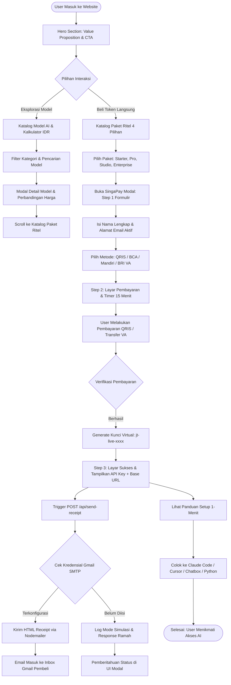
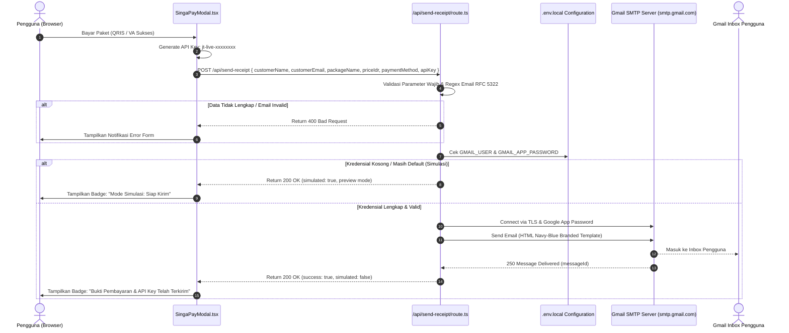
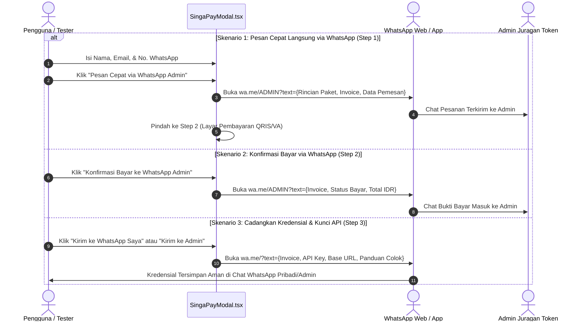
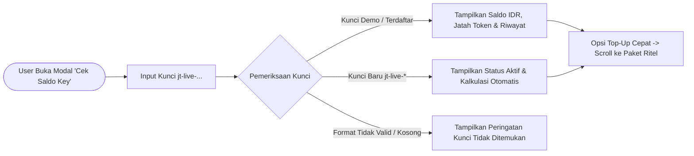

# Product Requirement Document (PRD): Juragan Token

**Versi Dokumen:** 1.2.0  
**Status:** Living Document / Aktif  
**Tanggal Pembaruan:** 30 Oktober 2026  
**Platform:** Web Application (Next.js 16.4.2 App Router, TypeScript, Vanilla CSS)  

---

## 1. Ikhtisar Produk (Product Overview)

### 1.1 Latar Belakang & Masalah
Banyak developer, periset, mahasiswa, dan pembuat konten di Indonesia yang ingin memanfaatkan AI global tercanggih (Claude 3.5 Sonnet, Claude Opus 5.5, OpenAI GPT-4o / GPT-6, Google Gemini 3.8 Flash, DeepSeek V4, Alibaba Qwen 2.5, dsb). Namun, mereka menghadapi hambatan besar:
1. **Ketiadaan Kartu Kredit Internasional:** Provider resmi (OpenAI, Anthropic, Google Cloud) mewajibkan kartu kredit Visa/Mastercard internasional dengan 3D Secure.
2. **Komitmen Biaya Langganan yang Mahal:** Paket resmi $20/bulan (±Rp 330.000 - Rp 350.000) terasa memberatkan untuk kebutuhan sesekali atau mahasiswa dengan budget terbatas.
3. **Masa Berlaku Kedaluwarsa:** Kredit resmi seringkali memiliki masa kedaluwarsa bulanan (*use-it-or-lose-it*).

### 1.2 Solusi: Juragan Token
**Juragan Token** adalah platform marketplace kredit API Multi-AI prabayar lokal pertama di Indonesia yang:
- Mengonversi kuota API resmi ke dalam rupiah (IDR) dengan sistem **Pay-As-You-Go** prabayar.
- Menyediakan paket ritel mulai dari **Rp 15.000** tanpa kartu kredit.
- Menerima metode pembayaran lokal Indonesia (**QRIS Instan**, Virtual Account **BCA, Mandiri, BRI** melalui SingaPay).
- Memberikan **1 Virtual API Key (`jt-live-...`)** yang kompatibel dengan protokol OpenAI (`base_url: https://gateway.juragantoken.co.id/v1`) yang dapat dipakai di berbagai aplikasi (Cursor AI, Claude Code CLI, Windsurf, Chatbox, Script Python).
- **Masa aktif token selamanya** (tanpa kedaluwarsa bulanan).
- Mengirimkan **bukti transaksi dan kredensial API Key secara otomatis ke Gmail pengguna**.

---

## 2. Arsitektur & Diagram Alur (Flowcharts)

### 2.1 Alur Pengguna Utama (End-to-End User Journey Flowchart)



---

### 2.2 Alur Sistem Pengiriman Email (Gmail SMTP Integration Flowchart)



---

### 2.3 Alur Pemesanan & Notifikasi WhatsApp (Testing & Direct Orders)



---

### 2.4 Alur Cek Saldo & Validasi Token (Token Balance Flowchart)



---

## 3. Spesifikasi Fungsional (Feature Specifications)

| Modul | Komponen / File | Deskripsi Fungsional |
| :--- | :--- | :--- |
| **Header & Navigasi** | `page.tsx`, `BrandMark.tsx` | Brand logo khas (3 balok bertingkat), sliding indicator tab navigasi, badge bendera Indonesia (IDR), tombol pintas *Cek Saldo Key*, tombol CTA *Beli Token*, dan menu responsif mobile. Shortcut keyboard `/` untuk auto-fokus search bar. |
| **Hero Section** | `page.tsx` | Value proposition utama, announcement pill, trust strip (15+ Model, 100% Prabayar, Aktif Selamanya, Gateway Indonesia), dan CTA eksplorasi. |
| **Katalog Model & Gateway Sync** | `page.tsx`, `catalog.ts`, `/api/models/sync` | Katalog 15+ model AI global dengan filter kategori (*Semua*, *Ngoding*, *Tugas & Riset*, *Gambar*), sortir harga/unggulan, pencarian instan, bookmark model, modal detail model, dan sinkronisasi live gateway pricing. |
| **Kalkulator Biaya IDR** | `SavingsCalculator.tsx`, `catalog.ts` | Konversi rasio token resmi ke rupiah berdasarkan kurs acuan USD (Rp 16.250). |
| **Katalog Paket Ritel** | `page.tsx` (`#katalog-retail`) | 4 kartu paket flat siap bayar (Starter Rp 15rb, Pro Rp 49rb, Studio Rp 99rb, Custom Enterprise) dengan tipografi profesional, badge rekomendasi, estimasi jumlah token, dan tombol beli langsung. |
| **Sistem Checkout SingaPay** | `SingaPayModal.tsx`, `Dialog.tsx` | Modal multi-step checkout: input identitas pembeli, nomor WhatsApp, pemilihan metode bayar (QRIS/VA), layar instruksi dengan timer 15 menit, dan layar sukses yang mengekspos API Key + Base URL. |
| **Integrasi Notifikasi WhatsApp** | `SingaPayModal.tsx`, `page.tsx` | Opsi pesan langsung via WhatsApp Admin di Step 1, tombol konfirmasi bayar WhatsApp di Step 2, tombol cadangkan kredensial ke WhatsApp pribadi/admin di Step 3, serta link bantuan WhatsApp di footer. |
| **Integrasi Notifikasi Email** | `/api/send-receipt/route.ts` | Endpoint backend berbasis Nodemailer untuk mengirim bukti bayar resmi dan kredensial API Key dengan template HTML responsif, fallback aman, dan pesan informatif. |
| **Panduan Setup 1-Menit** | `SetupGuides.tsx` | Tab panduan siap salin untuk Claude Code CLI, Cursor AI / Windsurf, Chatbox Web & App, serta script Python. |
| **Portal Cek Saldo Key** | `TokenBalanceModal.tsx` | Modal verifikasi saldo sisa IDR, estimasi token, dan riwayat pemakaian per model. |
| **FAQ Interaktif** | `page.tsx` (`#faq`) | Accordion pertanyaan krusial yang bersih, relevan, dan bebas duplikasi penjelasan teknis. |

---

## 4. Status Implementasi Detail (Gap Analysis & Audit Status)

Berikut adalah rekapitulasi audit status implementasi fitur per tanggal 30 Oktober 2026:

```
[✓] SUDAH DIIMPLEMENTASIKAN (100% Siap & Berfungsi)
[~] SEBAGIAN / SIMULASI (Frontend Aktif, Backend Membutuhkan Kredensial / Webhook Eksternal)
[ ] BELUM DIIMPLEMENTASIKAN (Roadmap Tahap Berikutnya)
```

### 4.1 Frontend & User Interface
- [x] **[✓] Sistem Navigasi Responsif:** Sliding indicator mengikuti posisi scroll/hover, mobile menu toggle, sticky blur header.
- [x] **[✓] Identitas Desain & Brand:** Logo tiga balok miring Juragan Token (SVG native), tema terang elegan (`#0a2442`, `#0a4ea3`, `#f5f8fb`), font Plus Jakarta Sans & IBM Plex Sans.
- [x] **[✓] Hero Section & Value Proposition:** Headline tajam, badge IDR, jaminan tanpa kartu kredit internasional.
- [x] **[✓] Katalog Model Interaktif:** 15+ model AI (Claude Sonnet 5.5, Claude Opus 5.5, GPT-4o, Gemini 3.8 Flash, DeepSeek V4, Qwen 2.5, Kimi, Flux, dll).
- [x] **[✓] Filter, Search & Bookmark:** Filter kategori instan, pencarian berbasis keyword/provider, bookmark lokal (`savedIds`), shortcut `/`.
- [x] **[✓] Modal Detail Model:** Spesifikasi token context window, input/output capabilities, dan perbandingan harga IDR.
- [x] **[✓] Paket Ritel 4 Kolom Rapi:** Desain flat profesional tanpa emoji anak-anak, tinggi kartu sejajar, harga transparan, estimasi token jelas.
- [x] **[✓] Panduan Setup 1-Menit:** 4 Tab interaktif dengan tombol "Salin Kode" (Claude Code, Cursor, Chatbox, Python).
- [x] **[✓] FAQ Bersih & Bebas Duplikasi:** 5 butir FAQ accordion esensial yang tidak tumpang tindih dengan panduan setup.
- [x] **[✓] Penghapusan Fitur `/langganan-resmi`:** Sesuai instruksi pemilik produk, fokus dialihkan 100% ke penjualan token API prabayar.

### 4.2 Alur Transaksi, Checkout & WhatsApp
- [x] **[✓] Modal SingaPay (Step 1 - Identitas & Channel):** Form Nama, Email, Nomor WhatsApp, pilihan QRIS, BCA VA, Mandiri VA, BRI VA.
- [x] **[✓] Pesan Langsung via WhatsApp Admin (Step 1):** Tombol hijau direct-order yang otomatis menyusun teks invoice rapi dan membuka chat WhatsApp admin.
- [x] **[✓] Modal SingaPay (Step 2 - Instruksi & Timer):** Tampilan QRIS simulasi / Nomor VA, nominal unik, timer hitung mundur 15 menit.
- [x] **[✓] Konfirmasi Bayar via WhatsApp (Step 2):** Tombol kirim konfirmasi bayar WhatsApp dengan payload no. invoice, paket, nominal, dan data pemesan.
- [x] **[✓] Modal SingaPay (Step 3 - Aktivasi Kunci):** Penyerahan Virtual API Key resmi dari server (`jt-live-...`), Base URL Gateway, tombol salin instan.
- [x] **[✓] Verifikasi Pembayaran & Centang Hijau Fintech (Step 3):** Animasi stroke centang hijau profesional (`PaymentSuccessMark`) ala GoPay/BCA, serta SingaPay Receipt Card resmi berisikan nomor invoice, nominal, metode bayar, dan stempel LUNAS & TERVERIFIKASI.
- [x] **[✓] Pembuatan Kunci API Server-Side:** Kunci virtual dibuat di server via CSPRNG (`crypto.randomBytes`), di-hash dengan SHA-256, dan hanya diungkapkan satu kali pada saat konfirmasi/polling pembayaran.
- [x] **[✓] Cadangkan Bukti & API Key ke WhatsApp (Step 3):** Opsi kirim salinan lengkap kredensial ke WhatsApp diri sendiri maupun ke WhatsApp admin (081226983990).
- [x] **[✓] Bantuan WhatsApp di Footer:** Tautan langsung ke WhatsApp resmi Juragan Token di footer beranda.
- [x] **[✓] Server Order Lifecycle & Polling:** Polling otomatis status order via `GET /api/orders/[id]` terlindungi `x-order-token` dan endpoint konfirmasi aman `POST /api/orders/[id]/confirm`.

### 4.3 Layanan Email (Gmail SMTP Integration)
- [x] **[✓] Server-Side Email Dispatcher (`lib/receipt-email.ts`):** Validasi input, HTML escaping anti-XSS, formatting IDR, tanggal transaksi Indonesia, pemanggilan otomatis di server saat pesanan terkonfirmasi lunas.
- [x] **[✓] Template Email HTML:** Desain responsif Navy Blue branded, kotak kredensial rahasia, petunjuk colok kilat.
- [x] **[✓] Fallback Cerdas (Smart Dry-Run):** Jika kredensial belum ada di `.env.local`, sistem tetap mencatat status pengiriman email tersimulasi secara aman tanpa error/crash.
- [x] **[✓] Status Pill Otomatis:** Modal SingaPay menerima status email langsung dari data pesanan server (*sending*, *sent*, *simulated*, *error*).
- [ ] **[~] Kredensial Riil Google App Password:** Menunggu pengisian Sandi Aplikasi 16 karakter dari akun Google pemilik produk di `.env.local` agar email dapat langsung meluncur ke inbox pengguna.

### 4.4 Data & Persistensi Backend
- [x] **[✓] Gateway Pricing Synchronizer (`/api/models/sync`):** Fetcher endpoint dengan timeout, fallback cache internal, dan dynamic price recalculation.
- [x] **[✓] Portal Cek Saldo Riil (`TokenBalanceModal.tsx` & `/api/keys/check`):** Menggunakan data kunci server riil (SHA-256 hash lookup), proteksi rate-limiting (10 req/menit), masking kunci (`jt-live-...xxxx`), status keaktifan permanen, serta tombol 1-klik "Tempel Kunci Terakhir". Bebas dari mock keys.
- [x] **[✓] Atomic Store Persistensi (`lib/store.ts`):** Penyimpanan persisten lokal berbasis JSON dengan antrian mutasi atomik (*read-modify-write queue*) untuk data `orders` dan `keys`.
- [ ] **[ ] Reverse Proxy Gateway Server:** Gateway `https://gateway.juragantoken.co.id/v1` merupakan arsitektur target; server proxy sesungguhnya (LiteLLM / One-API / custom Go proxy) dikelola secara terpisah dari web frontend ini.

---

## 5. Ringkasan Status Berdasarkan Skala Prioritas

| Fitur | Kategori | Tingkat Kesiapan | Catatan Operasional |
| :--- | :--- | :---: | :--- |
| **Katalog & Navigasi Web** | Frontend | **100% Siap** | Tampilan modern, responsif, accessibility audit lolos. |
| **Paket Ritel & FAQ** | Frontend | **100% Siap** | Telah dirapikan, bebas emoji, tata letak seimbang. |
| **Modal SingaPay & WhatsApp Flow** | Frontend | **100% Siap** | Alur 3 tahap interaktif + integrasi pesan/konfirmasi WhatsApp selesai & teruji. |
| **Verifikasi Pembayaran & Centang Hijau** | UI/UX | **100% Siap** | Animasi `PaymentSuccessMark` (GoPay/BCA style) + SingaPay Receipt Card. |
| **Pembuatan Kunci API Server-Side** | Keamanan | **100% Siap** | Random CSPRNG + SHA-256 hash + one-time reveal. Bebas `Math.random()` client. |
| **Integrasi Notifikasi WhatsApp** | Integrasi | **100% Siap** | Direct chat, invoice otomatis, konfirmasi bukti bayar ke `081226983990`. |
| **Cek Saldo Key** | Backend/Data | **100% Siap** | Terverifikasi server via `/api/keys/check`, rate limited, masked keys. |
| **Engine Email Nodemailer** | Backend | **95% Siap** | Kode server-side siap; menunggu input App Password di `.env.local`. |
| **Persistensi Transaksi & Kunci** | Backend/Data | **100% Siap** | Atomic file store (`data/store.json`) dengan safe locking. |
| **Webhook Payment Gateway** | Backend | **80% Siap** | Endpoint konfirmasi `/api/orders/[id]/confirm` siap dipanggil webhook/admin secret. |

---

## 6. Rekomendasi Langkah Selanjutnya (Actionable Next Steps)

1. **Aktivasi Pengiriman Email Riil (Opsional - Estimasi 3 Menit):**
   - Buka akun Google pengirim di [Google App Passwords](https://myaccount.google.com/apppasswords).
   - Buat Sandi Aplikasi 16 karakter (pilih app: *Mail*, device: *Other*).
   - Masukkan ke `.env.local`:
     ```env
     GMAIL_USER="namaemail@gmail.com"
     GMAIL_APP_PASSWORD="xxxx xxxx xxxx xxxx"
     ```

2. **Koneksi Reverse Proxy Gateway:**
   - Sambungkan kunci `jt-live-...` yang tersimpan di store ke database LiteLLM / One-API proxy gateway `https://gateway.juragantoken.co.id/v1`.

