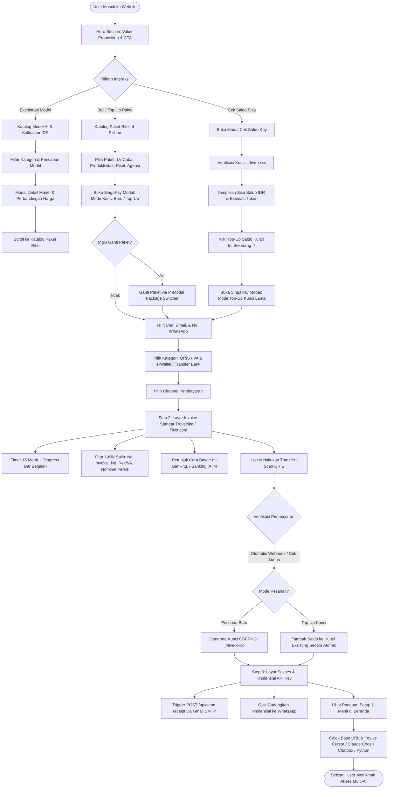
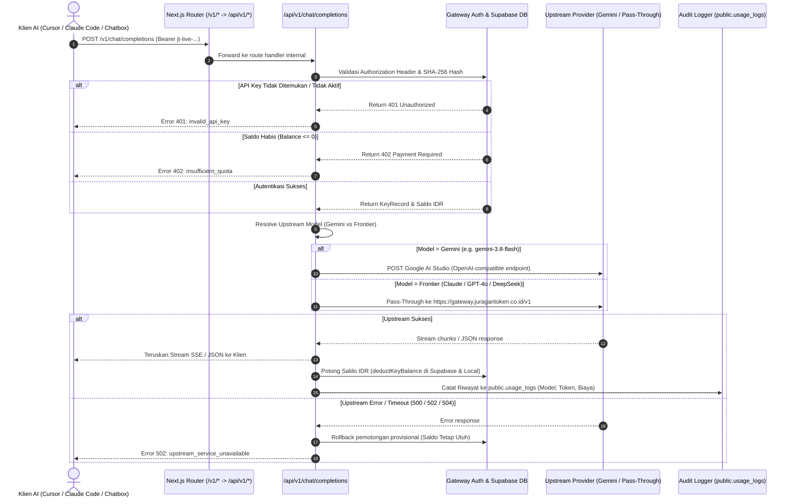
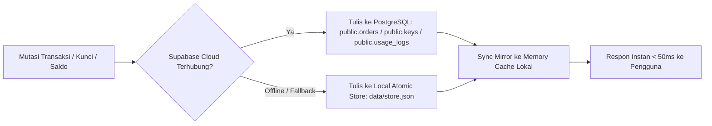
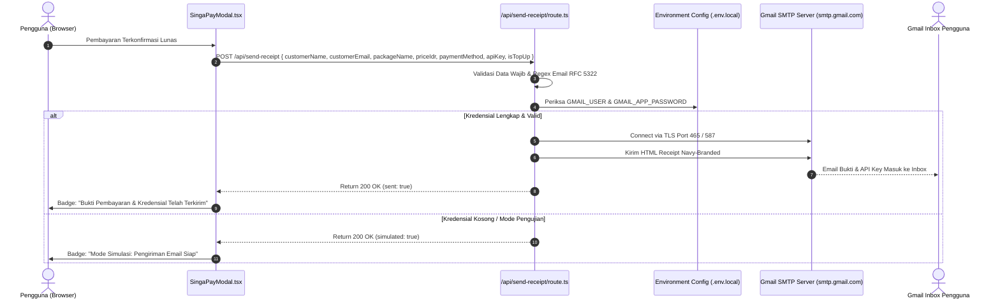
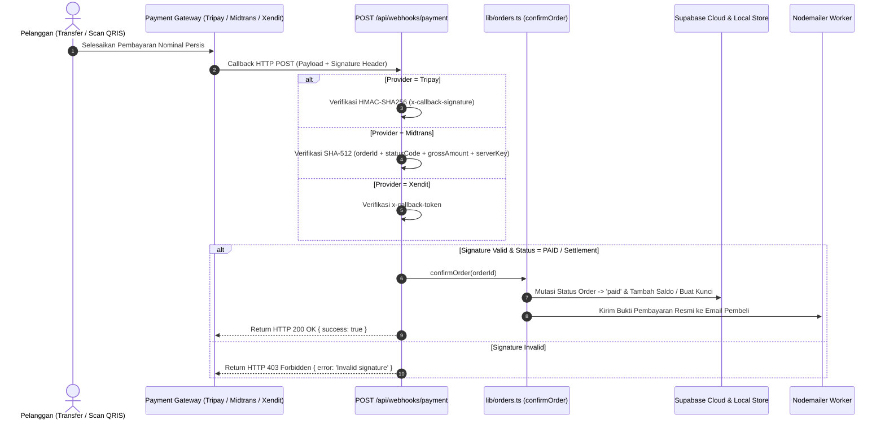

# Product Requirement Document (PRD): Juragan Token

**Versi Dokumen:** 2.2.0  
**Status:** Living Document / Production-Ready Architecture  
**Tanggal Pembaruan:** 10 November 2026  
**Platform:** Web Application (Next.js 16.4.2 App Router, TypeScript, Vanilla CSS, Supabase Cloud)  
**Repository:** `Whyzenn07/juragan-token-web`  

---

## 1. Ikhtisar Produk (Product Overview)

### 1.1 Latar Belakang & Masalah
Adopsi kecerdasan buatan (Frontier AI: Claude Sonnet 5.5, Claude Opus 5.5, OpenAI GPT-4o, Google Gemini 3.8 Flash, DeepSeek V4, Alibaba Qwen 2.5) kini telah menjadi kebutuhan lintas sektor di Indonesia: mulai dari **pemilik bisnis ritel & UKM** (analisis penjualan, copywriting katalog, otomatisasi CS), **agensi digital & kreator**, hingga **software engineer, periset, dan mahasiswa**. 

Namun, mereka menghadapi hambatan struktural yang signifikan:
1. **Ketiadaan Kartu Kredit Internasional:** Provider resmi (OpenAI, Anthropic, Google Cloud) mewajibkan kartu kredit Visa/Mastercard internasional dengan otentikasi 3D Secure yang sulit diakses oleh pelaku usaha lokal dan mahasiswa.
2. **Komitmen Biaya Langganan Bulanan yang Kaku:** Paket resmi $20/bulan (±Rp 330.000 - Rp 350.000 per layanan) terasa memberatkan untuk kebutuhan fleksibel atau eksplorasi awal.
3. **Masa Berlaku Kedaluwarsa (*Use-It-Or-Lose-It*):** Kredit resmi bulanan hangus jika tidak habis terpakai dalam 30 hari.
4. **Fragmentasi Kunci API:** Pengembang dan pengguna bisnis harus mengelola banyak akun, kartu kredit, dan dashboard terpisah untuk setiap provider AI.

### 1.2 Solusi: Juragan Token
**Juragan Token** adalah platform marketplace & gateway kredit Multi-AI prabayar lokal pertama di Indonesia yang berfungsi sebagai:
- **Toko Ritel & Kasir Pembayaran IDR Fleksibel:** Memungkinkan pembelian kredit API mulai dari **Rp 15.000** menggunakan metode pembayaran lokal Indonesia (**QRIS Instan**, Virtual Account & e-Wallet **DANA, ShopeePay, OVO, GoPay, BCA, Mandiri, BRI, BNI**, serta Transfer Bank **BCA, Mandiri, BRI, BNI, BSI**).
- **Universal OpenAI-Compatible AI Gateway:** Menyediakan **1 Virtual API Key (`jt-live-...`)** dengan Base URL standar (`https://www.juragantoken.co.id/v1`) yang dapat langsung dicolokkan ke berbagai *coding tools* dan klien populer (Cursor AI, Windsurf, Claude Code CLI, Chatbox, dan Python SDK).
- **Siklus Ganda (Dual-Lifecycle): Kunci Baru & Top-Up Kunci Lama:** Pengguna baru menerima kunci API unik, sementara pengguna lama dapat melakukan isi ulang (*top-up*) saldo ke kunci yang sama secara idempoten tanpa perlu mengubah konfigurasi IDE mereka.
- **Hybrid Upstream Routing Berkecepatan Tinggi:** 
  1. *Direct Engine:* Permintaan Google Gemini diproses langsung secara lokal ke Google AI Studio (`gemini-3.8-flash`) menggunakan Master Key berkecepatan tinggi.
  2. *Pass-Through Engine:* Permintaan model frontier berdaya tinggi (Claude Opus 5.5, Claude Sonnet 5.5, GPT-4o, DeepSeek) diteruskan secara aman ke Central Engine di `https://gateway.juragantoken.co.id/v1` (bebas dependensi OpenRouter).
- **Masa Aktif Token Permanen:** Saldo kredit dalam mata uang rupiah (IDR) berlaku permanen tanpa kedaluwarsa bulanan.
- **Zero-Retention Prompt Privacy:** Server Juragan Token hanya bertindak sebagai *pass-through proxy*. Tidak ada pencatatan atau penyimpanan teks prompt, dokumen bisnis, maupun respon AI ke database. Hanya metrik token kuantitatif yang dicatat untuk kebutuhan pengurangan saldo.
- **Dual Persistence & Audit Log:** Setiap transaksi dan pemakaian kredit tersinkronisasi secara *real-time* ke **Supabase Cloud Database** dengan failover penyimpanan lokal atomik.

---

## 2. Arsitektur & Diagram Alur (Flowcharts)

### 2.1 Alur Pengguna Utama (End-to-End User Journey)



---

### 2.2 Alur Universal AI Gateway & Deduplikasi Saldo (AI Inference Flowchart)



---

### 2.3 Alur Dual-Persistence Data (Cloud Database & Local Fallback)



---

### 2.4 Alur Sistem Notifikasi Email (Gmail SMTP Integration)



---

### 2.5 Alur Webhook Otomatis Payment Gateway (Tripay, Midtrans, Xendit)



---

## 3. Spesifikasi Fungsional Produk (Feature Specifications)

| Modul | Komponen / Endpoint | Deskripsi Fungsional & Standar Teknis |
| :--- | :--- | :--- |
| **Universal AI Gateway** | `/v1/chat/completions`<br>`/api/v1/chat/completions` | Endpoint kompatibel 100% dengan OpenAI API. Mendukung Server-Sent Events (SSE) streaming dan non-streaming JSON. Dilengkapi validasi bearer token, error format standar OpenAI, dan header CORS lengkap. |
| **Model Registry & Sync** | `/v1/models`<br>`/api/models/sync` | Mengembalikan daftar model yang tersedia (`gemini-3.8-flash`, `gemini-1.5-pro`, `claude-sonnet-5-5`, `claude-opus-5-5`, `gpt-4o`, `deepseek-chat`). Sinkronisasi harga live IDR per 1k token. |
| **Router Rewrite** | `next.config.ts` | Konfigurasi internal rewrites: mapping otomatis dari `/v1/:path*` ke `/api/v1/:path*` agar klien AI pihak ketiga (Cursor/Claude CLI) dapat langsung memanggil root URL. |
| **Deduplikasi Saldo & Metering** | `src/lib/gateway.ts` | Perhitungan tarif rupiah riil per request berdasarkan jumlah token input/output. Mengurangi `balance_idr` secara atomik di Supabase dan lokal. |
| **Audit Usage Logging** | `public.usage_logs` | Pencatatan riwayat pemakaian API setiap kali request inferensi selesai (mencatat model, provider, prompt tokens, completion tokens, biaya IDR, dan sisa saldo). |
| **Portal Cek Saldo Key** | `TokenBalanceModal.tsx`<br>`/api/keys/check` | Modal verifikasi saldo sisa IDR, estimasi token, status keaktifan permanen, proteksi rate-limiting (10 req/menit), masking kunci (`jt-live-...xxxx`), dan tombol 1-klik "Tempel Kunci Terakhir". |
| **Integrasi Cek Saldo ➔ Direct Top-Up** | `TokenBalanceModal.tsx` ➔ `PaymentModal.tsx` | Alur konversi langsung: tombol *"Top-Up Saldo Kunci Ini Sekarang ↗"* membuka kasir checkout dalam mode `topup` dengan data API Key yang langsung terisi dan terverifikasi otomatis. |
| **Mode Top-Up Kunci yang Ada** | `SingaPayModal.tsx`<br>`src/lib/orders.ts` | Mode khusus untuk pelanggan lama yang ingin menambah saldo ke kunci yang sama tanpa perlu mengubah konfigurasi API key di Cursor atau terminal. |
| **In-Modal Package Switcher** | `SingaPayModal.tsx` | Dropdown interaktif di dalam kartu ringkasan pesanan (*order summary*) untuk berpindah paket secara instan tanpa perlu menutup modal. |
| **Universal Webhook Engine** | `/api/webhooks/payment/route.ts` | Endpoint terpadu yang memproses notifikasi pembayaran otomatis dari Tripay (HMAC-SHA256), Midtrans (SHA-512), dan Xendit. |
| **Sinkronisasi Kurs Real-Time (BI Rate)** | `CurrencyRateModal.tsx`<br>`src/app/page.tsx` | Menampilkan modal kurs valas Bank Indonesia dengan visual grafik tren historis (1HR s/d Maks), perhitungan margin proteksi selisih kurs, dan pemicu pembaruan katalog tarif live. |
| **Katalog Model Favorit** | `src/app/page.tsx` | Fitur simpan/bookmark model AI favorit dengan filter `Tersimpan (★)` yang tersimpan di memori browser pengguna. |
| **Panduan Setup 4-in-1** | `SetupGuides.tsx` | Tab panduan interaktif siap salin dengan deteksi otomatis Base URL origin (`http://localhost:3000/v1` di dev, atau `https://www.juragantoken.co.id/v1` saat live) untuk: Cursor AI, Claude Code CLI, Chatbox, dan Python SDK. |
| **Sistem Checkout Multi-Channel & Accordion** | `SingaPayModal.tsx` | Modal checkout 3 langkah dengan navigasi accordion interaktif bersusun halus (QRIS, VA & e-Wallet, Transfer Bank), validasi form, breakdown transparan, dan integrasi WhatsApp. |
| **Invoice Standar Traveloka / Tiket.com** | `SingaPayModal.tsx` (Step 2) | Layar invoice pembayaran resmi OTA benchmark: countdown timer 15 menit dengan recovery batas waktu habis, tombol 1-klik salin nomor invoice, salin nomor rekening/VA (tanpa terpotong), salin nominal persis, serta petunjuk pembayaran multi-tab. |
| **Integrasi Notifikasi WhatsApp** | `SingaPayModal.tsx`, `page.tsx` | Pesan langsung via WhatsApp Admin di Step 1, konfirmasi bayar WhatsApp di Step 2, cadangkan kredensial ke WhatsApp pribadi/admin di Step 3, serta link bantuan WhatsApp di footer (`081226983990`). |
| **Layanan Email Kuitansi** | `/api/send-receipt/route.ts` | Endpoint server-side berbasis Nodemailer untuk mengirim bukti bayar resmi dan kredensial API Key dengan template HTML responsif Navy Blue branded. |
| **SEO & OpenGraph Metadata** | `src/app/layout.tsx` | Metadata komersial profesional: Title, Description berdaya konversi tinggi, OpenGraph WhatsApp preview, Twitter card, Canonical URL, dan bebas dari kata "simulasi". |

---

### 3.1 Arsitektur Pembayaran & Standar Desain Invoice (Benchmark Traveloka & Tiket.com)

1. **Pengelompokan Kanal Pembayaran (Interactive Accordion):**
   - **QRIS Instan:** Mendukung BCA, Mandiri, BRI, BNI, GoPay, OVO, ShopeePay, DANA, dan LinkAja (Bebas Biaya Admin, verifikasi instan).
   - **Virtual Account & e-Wallet:** Menampilkan 8 pilihan (DANA, ShopeePay, OVO, GoPay, BCA VA, Mandiri VA, BRI VA, BNI VA) dengan badge biaya transparan.
   - **Transfer Bank:** 5 bank nasional (BCA, Mandiri, BRI, BNI, BSI) dengan verifikasi cepat & rekening terdaftar resmi.
2. **Layar Invoice Resmi (Step 2):**
   - **Timer Dinamis:** 15 menit hitung mundur dengan progress bar visual berwarna emas/amber dan tombol *Perbarui Tagihan ↻* saat kedaluwarsa.
   - **Identitas Invoice & Order ID:** Nomor unik (`INV-YYYYMMDD-XXXX`) dengan tombol 1-klik salin.
   - **Nomor Rekening / VA Monospace Fit:** Disajikan dengan spasi terpisah yang pas tanpa terpotong di layar mobile berlayar sempit.
   - **Nominal Transfer Persis:** Angka rupiah total tebal dengan tombol 1-klik salin jumlah transfer.
   - **Petunjuk Cara Pembayaran Multi-Tab:** Tab interaktif `m-Banking`, `i-Banking`, dan `ATM`.

---

## 4. Status Implementasi Detail (Audit Codebase)

```
[✓] SUDAH DIIMPLEMENTASIKAN (100% Siap & Berfungsi di Codebase)
[~] SEBAGIAN / SIAP AKTIVASI (Logika Siap, Memerlukan Kredensial / Saklar Produksi)
[ ] ROADMAP TAHAP BERIKUTNYA
```

### 4.1 AI Gateway & Inference Engine
- [x] **[✓] Endpoint Kompatibel OpenAI (`/v1/chat/completions`):** Streaming SSE & non-streaming JSON aktif.
- [x] **[✓] Endpoint Daftar Model (`/v1/models`):** JSON response berstandar OpenAI models schema.
- [x] **[✓] Rewrites Router (`next.config.ts`):** Mapping `/v1/*` ke `/api/v1/*` selesai.
- [x] **[✓] Direct Master Key Routing Google Gemini:** Routing `gemini-3.8-flash` & `gemini-1.5-pro` langsung ke Google AI Studio dengan master key.
- [x] **[✓] Pass-Through Engine Frontier Models:** Routing Claude Opus 5.5, Claude Sonnet 5.5, GPT-4o, dan DeepSeek diteruskan ke `UPSTREAM_ENGINE_URL` (`juragantoken.co.id`). Dependensi OpenRouter telah dihapus 100%.
- [x] **[✓] Pemotongan Saldo Real-Time (`deductKeyBalance`):** Pemotongan IDR per request berbasis volume token.
- [x] **[✓] Audit Log Pemakaian (`recordUsageLog`):** Pencatatan riwayat pemakaian ke `public.usage_logs` dan memori lokal.

### 4.2 Data & Database Cloud (Supabase)
- [x] **[✓] Migrasi Tabel Orders & Keys:** `public.orders` dan `public.keys` aktif dengan Row Level Security (RLS).
- [x] **[✓] Migrasi Tabel Usage Logs:** `public.usage_logs` aktif dengan indeks pencarian per key hash dan waktu.
- [x] **[✓] Autentikasi Kunci SHA-256:** Kunci `jt-live-...` dienkripsi satu arah dengan SHA-256 sebelum disimpan. Kunci mentah tidak pernah disimpan permanen di database.
- [x] **[✓] Dual-Write Fallback:** Jika koneksi cloud mengalami latensi/gangguan, sistem otomatis beralih ke local atomic store (`data/store.json`).

### 4.3 E-Commerce, Kasir & Checkout Flow
- [x] **[✓] Alur Checkout Kunci Baru & Top-Up Kunci Eksisting:** Teruji penuh di `SingaPayModal.tsx` dan `orders.ts`.
- [x] **[✓] In-Modal Package Switcher:** Pengguna dapat berpindah paket ritel langsung di dalam modal.
- [x] **[✓] Integrasi Direct Top-Up Cek Saldo:** Tombol *"Top-Up Saldo Kunci Ini Sekarang ↗"* langsung meneruskan kunci ke kasir.
- [x] **[✓] Universal Webhook Handler (`/api/webhooks/payment`):** Verifikasi signature Tripay, Midtrans, dan Xendit.
- [x] **[✓] Panduan Setup Interaktif 4-in-1 (`SetupGuides.tsx`):** Tab dinamis untuk Cursor, Claude Code, Chatbox, Python.
- [x] **[✓] Metadata SEO & OpenGraph:** Tampilan share WhatsApp profesional dan bebas kata "simulasi".

### 4.4 Komponen Kesiapan Operasional (Pending Activation)
- [ ] **[~] Pengalihan Mode Demo ke Live (`NEXT_PUBLIC_DEMO_MODE=false`):** Saklar siap diputar ke `false` saat pembayaran QRIS merchant riil aktif.
- [ ] **[~] Gambar QRIS Merchant Resmi:** Menunggu unggah gambar QRIS berizin resmi ber-NMID (saat ini menggunakan vector QRIS mockup).
- [ ] **[~] Sandi Aplikasi Gmail SMTP (16 Karakter):** Sistem email siap meluncur ke inbox pembeli setelah Sandi Aplikasi Google dimasukkan ke `GMAIL_APP_PASSWORD`.

---

## 5. Spesifikasi Teknis Metering Saldo & Tarif IDR

Setiap request yang melalui gateway `/v1/chat/completions` dihitung biayanya menggunakan rumus berbasis jumlah total token:

$$\text{Biaya (IDR)} = \left\lceil \frac{\text{Prompt Tokens} + \text{Completion Tokens}}{1.000} \times \text{Tarif Model} \right\rceil$$

### 5.1 Tabel Acuan Tarif Model di Gateway

| Kategori Model | Model yang Didukung | Tarif per 1.000 Tokens | Minimal Potong per Request | Jalur Pemrosesan |
| :--- | :--- | :---: | :---: | :--- |
| **Gemini Flash (Super Hemat)** | `gemini-3.8-flash`, `gemini-2.0-flash` | **Rp 20** | Rp 5 | Direct Google AI Studio |
| **Gemini Pro (Analisis & Riset)** | `gemini-1.5-pro`, `gemini-pro-latest` | **Rp 60** | Rp 10 | Direct Google AI Studio |
| **Frontier Coding (Cerdas)** | `claude-sonnet-5-5`, `claude-3-5-sonnet` | **Rp 200** | Rp 25 | Pass-Through Central Engine |
| **Frontier Reasoning (Ultimate)** | `claude-opus-5-5`, `gpt-4o`, `deepseek-chat` | **Rp 200** | Rp 25 | Pass-Through Central Engine |

*Catatan untuk Streaming (SSE):* Saat client menggunakan opsi `stream: true`, sistem memotong estimasi saldo provisional di awal stream, mencatat log audit pemakaian, dan jika upstream gagal merespons, saldo provisional di-rollback seketika.

---

## 6. Spesifikasi Integrasi Klien (4-in-1 Client Connectors)

Sistem Juragan Token menjamin kompatibilitas 100% dengan 4 alat kerja utama pengembang:

### 6.1 Cursor AI & Windsurf IDE
- **Base URL:** `https://www.juragantoken.co.id/v1` (atau `http://localhost:3000/v1` pada tahap lokal)
- **API Key:** `jt-live-xxxxxxxxxxxxxxxxxxxx`
- **Model Override:** `claude-sonnet-5-5`, `gpt-4o`, `gemini-3.8-flash`
- **Konfigurasi:** Masuk ke `Cursor Settings` > `Models` > Aktifkan `OpenAI API Key` > Masukkan Base URL & API Key.

### 6.2 Claude Code CLI (Terminal Anthropic)
- **Environment Variables:**
  ```bash
  export ANTHROPIC_BASE_URL="https://www.juragantoken.co.id/v1"
  export ANTHROPIC_API_KEY="jt-live-xxxxxxxxxxxxxxxxxxxx"
  ```
- **Eksekusi:** Jalankan perintah `claude` langsung di terminal kerja.

### 6.3 Chatbox (Desktop & Web App)
- **AI Model Provider:** Pilih `OpenAI API`
- **API Host:** `https://www.juragantoken.co.id` (otomatis menambahkan `/v1`)
- **API Key:** `jt-live-xxxxxxxxxxxxxxxxxxxx`
- **Model:** `claude-opus-5-5` atau `gemini-3.8-flash`

### 6.4 Python OpenAI SDK
```python
from openai import OpenAI

client = OpenAI(
    base_url="https://www.juragantoken.co.id/v1",
    api_key="jt-live-xxxxxxxxxxxxxxxxxxxx"
)

response = client.chat.completions.create(
    model="gemini-3.8-flash",
    messages=[{"role": "user", "content": "Halo Juragan Token!"}]
)
print(response.choices[0].message.content)
```

---

## 7. Matriks Variabel Lingkungan (Environment Variables Matrix)

| Nama Variabel | Wajib/Opsional | Nilai Default / Format | Fungsi & Keterangan |
| :--- | :---: | :--- | :--- |
| `NEXT_PUBLIC_APP_URL` | Wajib | `https://www.juragantoken.co.id` | URL domain publik website untuk penentuan canonical SEO & OpenGraph. |
| `GATEWAY_BASE_URL` | Wajib | `https://gateway.juragantoken.co.id/v1` | URL gateway acuan pada email bukti pembayaran. |
| `NEXT_PUBLIC_SUPABASE_URL` | Wajib | `https://nzcblpzianzbgbwglhxc.supabase.co` | Endpoint REST API Cloud PostgreSQL Supabase. |
| `NEXT_PUBLIC_SUPABASE_ANON_KEY` | Wajib | `sb_publishable_...` | Kunci anon/publishable untuk query frontend & backend ke Supabase. |
| `SUPABASE_SECRET_KEY` | Opsional | `sb_secret_...` | Service Role Key untuk bypass RLS (keperluan migrasi database). |
| `GEMINI_API_KEY` | Wajib | `AQ.Ab8RN6KZoZ...` | Master API Key Google AI Studio untuk pemrosesan direct model Gemini Flash/Pro. |
| `UPSTREAM_ENGINE_URL` | Wajib | `https://gateway.juragantoken.co.id/v1` | Endpoint Central Engine untuk pass-through request Claude/GPT-4o/DeepSeek. |
| `UPSTREAM_ENGINE_KEY` | Opsional | `sk-...` | Token otentikasi internal jika Central Engine mewajibkan master header khusus. |
| `TRIPAY_PRIVATE_KEY` | Opsional | String Kunci Rahasia | Kunci rahasia untuk validasi HMAC-SHA256 callback Tripay. |
| `MIDTRANS_SERVER_KEY` | Opsional | String Kunci Server | Kunci rahasia untuk validasi hash SHA-512 callback Midtrans. |
| `XENDIT_CALLBACK_TOKEN` | Opsional | String Token | Token verifikasi header callback webhook Xendit. |
| `GMAIL_USER` | Opsional | `email@gmail.com` | Alamat Gmail resmi pengirim kuitansi pembelian. |
| `GMAIL_APP_PASSWORD` | Opsional | 16 Karakter Sandi Aplikasi | Sandi aplikasi Google untuk otentikasi aman tanpa 2FA. |
| `GMAIL_FROM_NAME` | Opsional | `Juragan Token Indonesia` | Nama pengirim yang tampil di inbox pembeli. |
| `NEXT_PUBLIC_WHATSAPP_NUMBER` | Wajib | `6281226983990` | Nomor WhatsApp resmi Customer Care & Konfirmasi Pesanan. |
| `DEMO_MODE` | Wajib | `"true"` atau `"false"` | Mengontrol tombol simulasi bayar di backend. |
| `NEXT_PUBLIC_DEMO_MODE` | Wajib | `"true"` atau `"false"` | Mengontrol tampilan badge dan tombol simulasi di modal frontend. |
| `ADMIN_SECRET` | Wajib | String acak panjang | Kunci pengaman untuk memicu konfirmasi manual pesanan via API. |

---

## 8. Tata Kelola, Keamanan & Metrik Produk (Product Governance & KPIs)

### 8.1 Kebijakan Privasi Data & Zero-Prompt Retention
Juragan Token didesain dengan prinsip keamanan data (*privacy-by-design*):
- **Stateless Streaming:** Seluruh payload percakapan pengguna (prompt, kode, dokumen, instruksi sistem) diteruskan secara langsung ke upstream provider melalui memori RAM tanpa pernah disimpan ke disk lokal maupun database PostgreSQL.
- **Audit Terbatas:** Tabel audit `usage_logs` hanya mencatat metrik kuantitatif: hash kunci API, nama model, jumlah prompt token, completion token, biaya rupiah, dan stempel waktu.

### 8.2 Concurrency Control & Runaway Spend Protection
- **Batas Konkurensi:** Maksimal 5 stream simultan per API key untuk menjaga stabilitas jalur upstream.
- **Rate-Limiting Kunci:** 60 request/menit untuk model umum, 20 request/menit untuk model frontier reasoning.
- **Pencegahan Saldo Minus:** Validasi saldo ketat sebelum inferensi dimulai memastikan pemakaian tidak pernah melampaui sisa saldo rupiah.

### 8.3 Target Metrik Keberhasilan Produk (KPIs)
1. **Checkout Completion Rate:** $\ge 70\%$ dari pengunjung yang membuka modal checkout berhasil menyelesaikan transaksi hingga `paid`.
2. **Top-Up Retention Rate:** $\ge 40\%$ pelanggan aktif melakukan pengisian ulang saldo dalam 30 hari.
3. **Gateway Proxy Latency Overhead:** Rata-rata penambahan latensi oleh gateway $\le 45\text{ ms}$.
4. **Instant Payment Activation:** Pembayaran terkonfirmasi otomatis dan kunci/saldo aktif dalam waktu $\le 5\text{ detik}$.

---

## 9. Langkah Verifikasi Fungsional (Sebelum Go-Live)

1. **Uji Coba Inferensi Kunci Aktif:**
   - Gunakan kunci aktif yang ada di database (`jt-live-ALbbK0UWHQg0ezVDdoFeDDzU`) untuk memanggil `POST /v1/chat/completions` dengan model `gemini-3.8-flash`.
   - Pastikan saldo di Supabase berkurang sesuai formula tarif.
   - Pastikan log transaksi tercatat di tabel `public.usage_logs`.
2. **Uji Coba Portal Cek Saldo & Top-Up Terusan:**
   - Masukkan kunci ke modal *Cek Saldo Key* di beranda.
   - Tekan tombol *Top-Up Saldo Kunci Ini Sekarang ↗* dan pastikan kasir terbuka dalam mode top-up dengan kunci terisi.
3. **Uji Coba Alur SingaPay Modal & In-Modal Switcher:**
   - Buka modal pembayaran, uji tombol ganti paket dan beralih antara QRIS dan Transfer Bank.
4. **Transisi Produksi Terakhir:**
   - Masukkan Sandi Aplikasi Gmail ke `GMAIL_APP_PASSWORD`.
   - Unggah gambar QRIS merchant resmi.
   - Ubah `NEXT_PUBLIC_DEMO_MODE="false"`.
